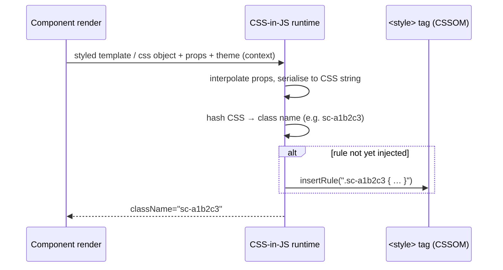

# CSS-in-JS

> CSS-in-JS writes styles in JavaScript or TypeScript next to components; runtime libraries (styled-components, Emotion) generate CSS in the browser at a real performance and Server Components cost, while zero-runtime libraries (Vanilla Extract, Linaria, Panda CSS, StyleX) extract static CSS at build time.

---

## What is it?

CSS-in-JS means writing a component's styles in the same JavaScript or TypeScript code as the component, instead of in a separate `.css` file.

The term covers two architectures that look similar in source code but behave very differently:

| | Runtime CSS-in-JS | Zero-runtime (build-time) CSS-in-JS |
|---|---|---|
| When CSS is generated | In the browser (and on the server during SSR), while components render | At build time, by a compiler/bundler plugin |
| What ships | A styling runtime + style definitions in the JS bundle | Static `.css` files + small class-name maps |
| Dynamic values | Any JS expression, evaluated per render | Must be statically analysable; runtime values go through CSS custom properties |
| Examples | styled-components, Emotion | Vanilla Extract, Linaria, Panda CSS, StyleX, Pigment CSS |

Both families provide **scoping** (generated class names), **co-location** (styles live with the component), and usually **typed theming** (tokens as TypeScript objects). See [CSS Modules and scoped styles](css-modules-and-scoped-styles.md) for the non-JS ways to get scoping.

---

## Why does it matter?

CSS-in-JS rose (roughly 2015–2020) because it solved real problems of component-based apps at once: global-namespace collisions, dead CSS that nobody dared delete, prop-driven variants, and themes passed through React context. For a while it was the default in the React ecosystem and in component libraries (MUI, Chakra UI, Ant Design v5).

The trade-offs became visible as apps grew and React changed:

- **Runtime cost** — serialising style objects, hashing, and injecting rules happens during render, on the main thread, and repeats when props change.
- **Bundle cost** — the library runtime plus every style definition ships as JavaScript, which must be downloaded, parsed and executed before styles exist.
- **SSR complexity** — styles must be collected during server render and flushed into the HTML, then rehydrated without duplication.
- **React Server Components** — runtime libraries depend on React context and client-side effects, so components using them must be Client Components.

In March 2025 the styled-components maintainer put the library into **maintenance mode** and stated he would not recommend styled-components or most other CSS-in-JS solutions for new projects (see References). That is the clearest signal of the ecosystem shift toward zero-runtime extraction, [utility-first CSS](utility-first-css.md), and plain CSS with modern features. Existing runtime CSS-in-JS code still works; the question is where to invest next — see [evolving and migrating styles](../../software-engineering/architecture/frontend/styling/evolving-and-migrating-styles.md).

---

## How it works

### Runtime CSS-in-JS (styled-components, Emotion)



Details that drive the costs:

- **Per-render work.** Each distinct set of interpolated props yields a different CSS string, a new hash and a new rule. Highly dynamic props (an animation value bound to state) can generate rules continuously.
- **Insertion timing.** React added `useInsertionEffect` specifically so CSS-in-JS libraries can inject rules before layout effects read the DOM; before that, libraries injected during render, which conflicts with concurrent rendering.
- **SSR.** On the server there is no CSSOM, so the library collects rules into a registry during render and the framework flushes them into `<head>` (Next.js uses a style registry plus `useServerInsertedHTML`). Streaming makes this harder: rules for each streamed chunk must be appended before the chunk's HTML.
- **Theming via context.** `ThemeProvider` passes tokens through React context. Server Components cannot use context, so any component reading the theme or calling `styled()` must be marked `"use client"`. Next.js documents styled-components and others as supported **in Client Components** only.
- **Size.** You ship the runtime (on the order of 10+ KB gzipped for common libraries) plus all style definitions as JS, which is executed rather than parsed natively by the CSS engine.

**Status (verified October 2026):**

- **styled-components** — in maintenance mode since the maintainer's announcement of 17 March 2025: occasional bug fixes, no new major capabilities, and an explicit recommendation against adopting it (or most CSS-in-JS) for new projects.
- **Emotion** — widely used (it is MUI's default engine). The Next.js App Router docs list Emotion under libraries still "working on support" for Server Components-era rendering. Treat it as stable for existing client-rendered code, not as a forward-looking choice for RSC apps.

### Zero-runtime CSS-in-JS

The common idea: **evaluate style definitions at build time** and emit static CSS, leaving only class names (strings) in the JavaScript.

```
 button.css.ts / css() calls          build plugin                       output
 ┌─────────────────────────┐   ┌──────────────────────────────┐   ┌──────────────────────┐
 │ style({ padding: … })   │──▶│ parse or evaluate the module │──▶│ app.css (static)     │
 │ tokens from theme.ts    │   │ resolve tokens, hash names   │   │ button.js: "btn_x1"  │
 └─────────────────────────┘   └──────────────────────────────┘   └──────────────────────┘
 runtime-dependent values  ──▶  compiled to var(--x) + inline style="--x: …"
```

Two extraction strategies:

- **Evaluation** — the plugin actually runs the style module in Node at build time (Vanilla Extract's `.css.ts` files; Linaria and Pigment via the `wyw-in-js` evaluator). Flexible (any build-time JS works), but style modules must be side-effect-free, and complex dependency graphs can slow builds.
- **Static analysis** — the plugin parses source code and only accepts statically resolvable values (Panda CSS, StyleX). Faster and more predictable, but more constrained: you cannot compute styles from arbitrary runtime data.

Dynamic values are handled the same way across tools: the property is compiled to `var(--something)` and the component sets `--something` as an inline style. The browser does the rest.

Output shape also differs:

- **Semantic/per-rule classes** (Vanilla Extract, Linaria, Pigment) — one class per style block; output grows with the number of styles.
- **Atomic classes** (StyleX, Panda CSS by default) — one class per property-value pair (`.x1e2nbdu { padding: 4px }`), shared across the app; total CSS size plateaus as the codebase grows. See [utility-first CSS](utility-first-css.md) for the atomic model.

### The zero-runtime libraries

| Library | Authoring | Extraction | Output | Notable traits |
|---|---|---|---|---|
| **Vanilla Extract** | `style()`, `createTheme()`, `recipe()` in `*.css.ts` files | Evaluates `.css.ts` modules at build time | Per-rule classes + static CSS | Type-safe theme contracts (`createThemeContract`); framework-agnostic; styles live in separate files, not inline in components |
| **Linaria** | `css` and `styled` tagged templates, inline in components | `wyw-in-js` evaluator | Per-rule classes | Closest syntax to styled-components; dynamic `styled` props become CSS variables |
| **Panda CSS** | `css({...})`, `cva()` recipes, patterns, optional JSX `styled` factory | Static analysis + codegen of a `styled-system` folder | Atomic classes in cascade layers | Token and semantic-token system, conditions (`_hover`, `_dark`), works with any framework |
| **StyleX** (Meta) | `stylex.create()`, `stylex.props()`, `stylex.defineVars()` | Babel/bundler plugin, static analysis | Atomic classes | "Last style applied wins" deterministic merging; disallows descendant selectors and styling at a distance |
| **Pigment CSS** (MUI) | `styled`/`css`, MUI-compatible theme API | `wyw-in-js` evaluator | Per-rule classes | Built as MUI's RSC-compatible engine; the repository is labelled **"Alpha phase, currently, on hold"** — do not build on it without checking current status |

### Trade-offs of zero-runtime

| Gain | Cost |
|---|---|
| No style runtime, no per-render style work | A bundler plugin in every build (Vite, webpack, Next.js, esbuild…) — tooling coupling |
| Works in Server Components (styles are static class names) | Dynamic styling limited to custom properties and pre-declared variants |
| Static CSS is cached, parsed by the CSS engine, and extractable for critical CSS | Build-time evaluation can be slow or surprising (side effects, invalidation) |
| Typed tokens and variants | Each library has its own API — migration between them is a rewrite |

---

## Examples

### Runtime: styled-components with a theme

```tsx
"use client"; // required under React Server Components: uses context + runtime injection

import styled, { ThemeProvider } from "styled-components";

const theme = { color: { brand: "oklch(0.55 0.18 250)", onBrand: "white" }, radius: "6px" };

const Button = styled.button<{ $size?: "sm" | "md" }>`
  border-radius: ${({ theme }) => theme.radius};
  background: ${({ theme }) => theme.color.brand};
  color: ${({ theme }) => theme.color.onBrand};
  padding: ${({ $size }) => ($size === "sm" ? "0.25rem 0.5rem" : "0.5rem 1rem")};
`;

export function Toolbar() {
  return (
    <ThemeProvider theme={theme}>
      <Button $size="sm">Save</Button>
    </ThemeProvider>
  );
}
```

Each `$size` value produces a separate generated class at runtime.

### Zero-runtime: Vanilla Extract with a typed theme contract

```ts
// theme.css.ts — evaluated at build time
import { createThemeContract, createTheme } from "@vanilla-extract/css";

export const vars = createThemeContract({
  color: { brand: null, onBrand: null },
  radius: null,
});

export const lightTheme = createTheme(vars, {
  color: { brand: "oklch(0.55 0.18 250)", onBrand: "white" },
  radius: "6px",
});
```

```ts
// button.css.ts
import { recipe } from "@vanilla-extract/recipes";
import { vars } from "./theme.css";

export const button = recipe({
  base: {
    borderRadius: vars.radius,              // compiles to var(--radius__abc)
    background: vars.color.brand,
    color: vars.color.onBrand,
  },
  variants: {
    size: {
      sm: { padding: "0.25rem 0.5rem" },
      md: { padding: "0.5rem 1rem" },
    },
  },
  defaultVariants: { size: "md" },
});
```

```tsx
// Button.tsx — can be a Server Component: only class-name strings remain
import { button } from "./button.css";

export function Button({ size, children }: { size?: "sm" | "md"; children: React.ReactNode }) {
  return <button className={button({ size })}>{children}</button>;
}
```

A typo in `vars.color.brnad` is a TypeScript error.

### Runtime values in a zero-runtime library: Linaria

```tsx
import { styled } from "@linaria/react";

const Bar = styled.div<{ progress: number }>`
  height: 4px;
  background: var(--color-brand);
  width: ${({ progress }) => `${progress}%`}; /* compiled to var(--bar-width) + inline style */
`;

export const Progress = ({ value }: { value: number }) => <Bar progress={value} />;
```

The CSS file is static; only the inline custom property changes per render.

### Atomic: StyleX with deterministic merging

```tsx
import * as stylex from "@stylexjs/stylex";

const styles = stylex.create({
  base: { padding: 8, borderRadius: 6, backgroundColor: "white" },
  danger: { backgroundColor: "crimson", color: "white" },
});

export function Alert({ danger, children }: { danger?: boolean; children: React.ReactNode }) {
  // later styles win for the same property — independent of CSS source order
  return <div {...stylex.props(styles.base, danger && styles.danger)}>{children}</div>;
}
```

### Panda CSS

```tsx
import { css } from "../styled-system/css"; // generated by Panda's codegen

export function Card({ children }: { children: React.ReactNode }) {
  return (
    <div className={css({ p: "4", rounded: "md", bg: "bg.surface", _hover: { shadow: "md" } })}>
      {children}
    </div>
  );
}
// Emits atomic classes such as .p_4, .rounded_md, .hover\:shadow_md inside @layer utilities
```

---

## When to use

- **Existing runtime CSS-in-JS codebases** — keep them running; new code can follow the same API while you plan a gradual migration.
- **Client-rendered apps (SPA) with heavily prop-driven styling** where the runtime cost has been measured and is acceptable.
- **Zero-runtime libraries for TypeScript-heavy design systems** — typed tokens, typed variants, static CSS, and Server Components compatibility (Vanilla Extract, Panda CSS, StyleX).
- **Atomic zero-runtime (StyleX, Panda) for very large apps** where CSS size must stay flat as the codebase grows and deterministic style merging matters.
- **Teams that want styles co-located in TS but not utility classes in markup.**

---

## When NOT to use

- **Runtime CSS-in-JS for new projects, especially with React Server Components** — it forces `"use client"` on styled components, adds runtime and SSR plumbing; its own maintainer recommends against it for new work.
- **Highly dynamic interpolations in runtime libraries** (values bound to scroll or animation state) — each value creates new rules; use custom properties or inline styles.
- **Pigment CSS for production commitments** — alpha and on hold at the time of writing.
- **Zero-runtime libraries where the build pipeline is fragile or shared across many tools** — every bundler, test runner and Storybook needs the plugin.
- **Non-JS-rendered pages** (server templates, CMS, Rails/Django views) — the whole model assumes components rendered from JavaScript.
- **When the team is strong in CSS and does not need typed styles** — CSS Modules or framework-scoped styles give scoping with fewer moving parts.

---

## References

- [Thank you — styled-components maintenance mode announcement](https://opencollective.com/styled-components/updates/thank-you) — maintainer post, March 2025
- [styled-components documentation](https://styled-components.com) — official
- [Emotion documentation](https://emotion.sh/docs/introduction) — official
- [Next.js: CSS-in-JS](https://nextjs.org/docs/app/guides/css-in-js) — official; support status in the App Router
- [React: `useInsertionEffect`](https://react.dev/reference/react/useInsertionEffect) — official
- [React: Server Components](https://react.dev/reference/rsc/server-components) — official
- [Vanilla Extract](https://vanilla-extract.style) — official
- [Linaria](https://linaria.dev) and [wyw-in-js](https://wyw-in-js.dev) — official
- [Panda CSS: Why Panda](https://panda-css.com/docs/overview/why-panda) — official
- [StyleX: Learn](https://stylexjs.com/docs/learn/) — official
- [Pigment CSS repository](https://github.com/mui/pigment-css) — official; status label
- [Why We're Breaking Up with CSS-in-JS](https://dev.to/srmagura/why-were-breaking-up-wiht-css-in-js-4g9b) — community post by an Emotion maintainer
