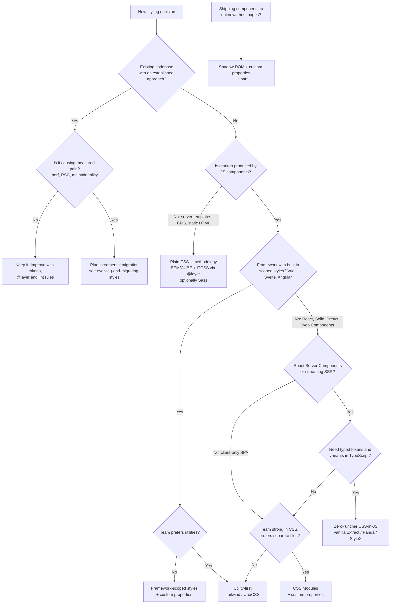

# Styling Approaches Compared

> A side-by-side comparison of eight ways to style a web UI — plain CSS, CSS with a methodology, Sass, CSS Modules, framework-scoped styles, runtime CSS-in-JS, zero-runtime CSS-in-JS and utility-first — across scoping, runtime cost, SSR/RSC compatibility, theming, type safety, learning curve, team scale and migration cost, with a decision flow.

---

## What is it?

This is a guide for choosing how a project writes and delivers its CSS, comparing the main options on the same criteria so the trade-offs are visible side by side.

The eight approaches compared:

| # | Approach | One-line definition | Deep dive |
|---|---|---|---|
| 1 | **Plain / global CSS** | Stylesheets loaded globally, no conventions or tooling beyond the browser | [Overview](overview.md) |
| 2 | **CSS + methodology** | Global CSS disciplined by BEM, ITCSS, CUBE, etc., ideally with `@layer` | [Methodologies](methodologies.md) |
| 3 | **Sass** | Preprocessor: variables, mixins, loops, modules compiled to CSS | [Sass](sass.md) |
| 4 | **CSS Modules** | Build-time renamed class names imported into JS | [CSS Modules and scoped styles](css-modules-and-scoped-styles.md) |
| 5 | **Framework-scoped styles** | Vue `<style scoped>`, Svelte styles, Angular view encapsulation | [CSS Modules and scoped styles](css-modules-and-scoped-styles.md) |
| 6 | **Runtime CSS-in-JS** | styled-components, Emotion: CSS generated while rendering | [CSS-in-JS](css-in-js.md) |
| 7 | **Zero-runtime CSS-in-JS** | Vanilla Extract, Linaria, Panda CSS, StyleX: CSS extracted at build time | [CSS-in-JS](css-in-js.md) |
| 8 | **Utility-first** | Tailwind CSS, UnoCSS: composed single-purpose classes, generated on demand | [Utility-first CSS](utility-first-css.md) |

These are not mutually exclusive layers. Sass is an *authoring* tool that can feed CSS Modules or framework-scoped styles; a methodology can organise the global layer around any scoped approach; and custom properties ([custom properties and theming](custom-properties-and-theming.md)) sit underneath all of them as the runtime theming mechanism.

---

## Why does it matter?

The styling approach is one of the hardest frontend decisions to reverse. It touches every component, shapes how designers and developers collaborate, constrains which rendering models you can adopt (React Server Components, streaming SSR), and determines what a migration costs years later. Teams often pick by popularity or familiarity and discover the costs late: a runtime CSS-in-JS library that blocks Server Components, global CSS nobody can delete, or utility classes in a codebase without a component layer.

A shared comparison makes the trade-offs explicit and gives a team vocabulary for an ADR. There is no universally best approach — but for a given context, some are clearly wrong.

---

## How it works

### Comparison matrix

Ratings are relative across the eight approaches, assuming idiomatic use.

| Axis | Plain CSS | CSS + methodology | Sass | CSS Modules | Framework-scoped | Runtime CSS-in-JS | Zero-runtime CSS-in-JS | Utility-first |
|---|---|---|---|---|---|---|---|---|
| **Scoping** | None | Convention only | None (authoring tool) | Build-time, per class | Build-time, per component | Generated classes | Generated classes | No naming → no collisions |
| **Runtime cost** | None | None | None | None | None (Vue `v-bind()` adds inline vars) | **High** — JS executes to produce CSS | None (inline custom properties for dynamic values) | None |
| **SSR / RSC compatibility** | Full | Full | Full | Full | Full in each framework's SSR | SSR needs a style registry; components must be **Client Components** under RSC | Full — static CSS | Full |
| **Theming** | Custom properties | Custom properties | Compile-time maps + custom properties | Custom properties | Custom properties (+ `v-bind()` in Vue) | JS theme via context (+ custom properties) | Typed theme contracts compiled to custom properties | Tokens in `@theme` emitted as custom properties |
| **Type safety** | None | None | Compile-time errors in Sass only | Optional (generated `.d.ts`) | Template-level only | Typed props and theme | **Strong** — typed tokens, variants | Weak (strings); editor tooling and lint plugins help |
| **Learning curve** | Low to start, high to master | Medium (team discipline) | Medium | Low | Low (part of the framework) | Low for React devs | Medium (build plugins, library API) | Medium (vocabulary), fast once learned |
| **Team scale** | Small | Medium–large with enforcement | Any (paired with scoping) | Medium–large | Medium–large | Medium–large | Large | Medium–large with a component layer |
| **Migration cost (to leave)** | n/a | Low | Low–medium (compile to CSS, then edit) | Low (it is CSS) | Low–medium (CSS, framework-bound) | **High** — styles are JS, coupled to the runtime API | High — library-specific APIs | Medium–high — styles live in markup |
| **Framework coupling** | None | None | None | Bundler | Framework | React (mostly) | Bundler plugin + library | Build tool; any template language |
| **Dead-code elimination** | Manual | Manual | Manual | Per-module (import graph) | Per-component | Automatic (only rendered styles) | Per-module / atomic | Automatic (scanned classes) |

### Hidden costs worth naming

- **Plain CSS** — cost grows non-linearly with team size: the stylesheet becomes append-only.
- **Methodologies** — enforced only by review and linting; drift is the default.
- **Sass** — a build step and a second language; `@import`-based code must migrate to `@use` before Dart Sass 3.0 removes `@import`.
- **CSS Modules** — dynamic styling needs custom properties or class toggling; `composes` ordering is unspecified across files.
- **Framework-scoped** — styles are tied to the framework's file format; cross-framework design systems need another layer (custom properties, Web Components).
- **Runtime CSS-in-JS** — runtime, bundle and SSR plumbing; styled-components is in maintenance mode (March 2025) and its maintainer recommends against new adoption.
- **Zero-runtime CSS-in-JS** — build-plugin coupling across every tool (bundler, test runner, Storybook); Pigment CSS is alpha and on hold.
- **Utility-first** — needs a component layer to avoid duplicated class strings; dynamic class names break generation.

### Decision flow



Runtime CSS-in-JS does not appear as a destination for new projects: under current ecosystem conditions there is no context where it is the best *new* choice, though it remains a valid choice to *keep*.

### Scenario shortcuts

| Context | Usually best | Reasonable alternative | Avoid |
|---|---|---|---|
| Marketing site, CMS theme, server templates | CSS + methodology (+ `@layer`) | Sass on top; utility-first if templated with partials | CSS-in-JS |
| Next.js / React Server Components app | Utility-first or CSS Modules | Zero-runtime CSS-in-JS | Runtime CSS-in-JS |
| Vue / Nuxt, Svelte / SvelteKit, Angular app | Framework-scoped styles | Utility-first (UnoCSS is common in Vue) | Runtime CSS-in-JS |
| Multi-framework design system | Tokens → custom properties; CSS (Modules or plain) or Web Components | Zero-runtime with framework-agnostic output (Vanilla Extract, Panda) | Framework-scoped styles, runtime CSS-in-JS |
| Large React monorepo, many teams | Zero-runtime atomic (StyleX, Panda) or utility-first | CSS Modules with strict token linting | Plain global CSS |
| Legacy app on styled-components / Emotion | Keep; migrate per component when touched | Zero-runtime with similar API (Linaria) to reduce rewrite cost | Big-bang rewrite |
| Embeddable widget / micro-frontend | Shadow DOM or CSS Modules with prefixes | `@scope` | Global CSS, utility frameworks sharing a global stylesheet with the host |

For cross-cutting concerns see [styling in monorepos](../../software-engineering/architecture/frontend/styling/styling-in-monorepos.md), [styling micro-frontends](../../software-engineering/architecture/frontend/styling/styling-micro-frontends.md), and [styling and rendering strategies](../../software-engineering/architecture/frontend/styling/styling-and-rendering-strategies.md).

---

## Examples

The same button — primary/ghost variants, themable brand color — in each approach.

### 1–2. Plain CSS with BEM + `@layer`

```css
@layer components {
  .button { padding: 0.5rem 1rem; border-radius: var(--radius-md); }
  .button--primary { background: var(--color-brand); color: var(--color-on-brand); }
  .button--ghost { background: transparent; color: var(--color-brand); }
}
```

```html
<button class="button button--primary">Save</button>
```

### 3. Sass

```scss
@use "tokens" as t;

.button {
  padding: t.space(2) t.space(4);
  border-radius: var(--radius-md);
  @each $variant, $bg in (primary: var(--color-brand), ghost: transparent) {
    &--#{$variant} { background: $bg; }
  }
}
```

### 4. CSS Modules

```tsx
import styles from "./Button.module.css"; // .root, .primary, .ghost

export const Button = ({ variant = "primary", ...rest }: Props) => (
  <button className={`${styles.root} ${styles[variant]}`} {...rest} />
);
```

### 5. Framework-scoped (Svelte)

```svelte
<script lang="ts">
  let { variant = "primary", children } = $props();
</script>

<button class={variant}>{@render children()}</button>

<style>
  button { padding: 0.5rem 1rem; border-radius: var(--radius-md); }
  .primary { background: var(--color-brand); color: var(--color-on-brand); }
  .ghost { background: transparent; color: var(--color-brand); }
</style>
```

### 6. Runtime CSS-in-JS (Emotion)

```tsx
"use client";
import styled from "@emotion/styled";

export const Button = styled.button<{ variant?: "primary" | "ghost" }>(({ theme, variant = "primary" }) => ({
  padding: "0.5rem 1rem",
  borderRadius: theme.radius.md,
  background: variant === "primary" ? theme.color.brand : "transparent",
}));
```

### 7. Zero-runtime CSS-in-JS (Panda CSS)

```tsx
import { cva } from "../styled-system/css";

const button = cva({
  base: { px: "4", py: "2", rounded: "md" },
  variants: { variant: { primary: { bg: "brand", color: "onBrand" }, ghost: { bg: "transparent", color: "brand" } } },
});

export const Button = ({ variant = "primary", ...rest }: Props) => <button className={button({ variant })} {...rest} />;
```

### 8. Utility-first (Tailwind)

```tsx
const variants = {
  primary: "bg-brand text-on-brand",
  ghost: "bg-transparent text-brand",
} as const;

export const Button = ({ variant = "primary", ...rest }: Props) => (
  <button className={`rounded-md px-4 py-2 ${variants[variant]}`} {...rest} />
);
```

Note what stays constant: every version themes through the same custom properties (`--color-brand`, `--radius-md`). Keeping tokens in custom properties is what makes switching between approaches tractable later.

---

## When to use

- **When starting a project** — run the decision flow, then record the choice and its reasons in an ADR.
- **When a styling pain point is measured** (RSC adoption blocked, bundle or runtime cost, dead CSS, specificity wars) — use the matrix to find which axis is failing and which approach fixes it.
- **When onboarding a team to an unfamiliar approach** — the "hidden costs" list sets expectations.
- **When defining a design system's distribution format** — the framework-coupling and theming rows decide what consumers can use.

---

## When NOT to use

- **As a reason to rewrite a working codebase** — switching approaches is expensive; migrate only for a measured problem, incrementally.
- **To mix approaches by preference** — two systems are justifiable during a migration or at a clear boundary (global layer + scoped components; design system vs app); three or more without boundaries is a maintenance cost.
- **As absolute rankings** — ratings are relative and depend on idiomatic use; a disciplined CSS Modules codebase beats a careless utility one.
- **Ignoring team skills** — the best-rated approach that nobody on the team knows well is often worse than a familiar one used well.
- **Treating library status as permanent** — maintenance status and versions change; re-check before deciding (this article was verified in October 2026).

---

## References

- [MDN: CSS](https://developer.mozilla.org/en-US/docs/Web/CSS) — official reference for native features
- [MDN: `@layer`](https://developer.mozilla.org/en-US/docs/Web/CSS/@layer) and [`@scope`](https://developer.mozilla.org/en-US/docs/Web/CSS/@scope)
- [Sass documentation](https://sass-lang.com/documentation/) — official
- [CSS Modules](https://github.com/css-modules/css-modules) — community specification
- [Vue: SFC CSS features](https://vuejs.org/api/sfc-css-features.html), [Svelte: Scoped styles](https://svelte.dev/docs/svelte/scoped-styles), [Angular: Styling components](https://angular.dev/guide/components/styling) — official
- [Next.js: CSS-in-JS](https://nextjs.org/docs/app/guides/css-in-js) — official; Server Components support status
- [styled-components maintenance mode announcement](https://opencollective.com/styled-components/updates/thank-you) — maintainer post, March 2025
- [Vanilla Extract](https://vanilla-extract.style), [Panda CSS](https://panda-css.com), [StyleX](https://stylexjs.com) — official
- [Tailwind CSS](https://tailwindcss.com) and [UnoCSS](https://unocss.dev) — official
- [CUBE CSS](https://cube.fyi) — community methodology by Andy Bell
