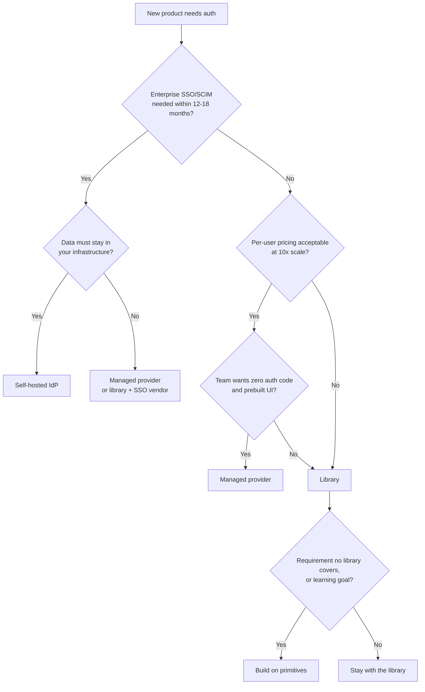

# Authentication: Build vs Buy

> How to decide between writing auth on top of primitives, adopting a library, paying for a managed provider, or running your own identity server — by product needs, compliance, cost, lock-in, and the team that will carry the pager.

---

## What is it?

Build vs buy for authentication is the decision about **who owns each piece of the auth chain**: your code, an open-source library running in your process, a vendor's hosted service, or an identity server you operate. It is rarely all-or-nothing — a common setup is a library for sessions plus a vendor only for enterprise SSO — but each choice moves responsibility, cost, and risk to a different place.

The four options:

| Option | You write | You operate | You pay |
|---|---|---|---|
| **Build on primitives** (`node:crypto`, Argon2, `jose`, `openid-client`) | Everything | Your app | Engineering time |
| **Library** (Auth.js, Better Auth, Passport) | Integration, UI, emails, policies | Your app + DB | Engineering time |
| **Managed provider** (Clerk, Auth0, WorkOS, …) | Integration, authorization | Nothing extra | Per user / per feature |
| **Self-hosted IdP** (Keycloak, Zitadel, …) | Integration, theming | A new critical service | Infrastructure + ops time |

---

## Why does it matter?

Authentication is a **generic subdomain** in Domain-Driven Design terms: every product needs it, almost none win because of it. The usual advice is to adopt it off the shelf and spend your effort on the core domain. But "off the shelf" hides real trade-offs:

- A managed provider removes the most work and the most risk of a home-grown mistake, and replaces them with a per-user bill, a vendor that holds your users, and an outage you cannot fix.
- A library keeps users in your database and costs nothing per user, but every CVE in it is your patch to ship, and features such as SAML or SCIM are often missing.
- Building from primitives gives full control, and every security property is yours to get right — and to keep right as the threat model changes.

Getting this wrong is expensive in both directions: migrating users out of a provider later can force password resets, and a home-grown system that grows by accretion becomes the riskiest code in the company.

---

## How it works

Score the options against five groups of criteria.

### 1. Product requirements

List what you need now and in the next 12–18 months:

- **Login methods** — password, magic link, social (OIDC), passkeys.
- **MFA** — TOTP, WebAuthn, recovery codes, step-up for sensitive actions.
- **B2B features** — organizations/tenants, invitations, roles per organization, **enterprise SSO (SAML/OIDC)**, **SCIM** user provisioning, audit logs, domain verification.
- **Machine identities** — API keys, OAuth client credentials for partners.

B2B requirements are the strongest pull toward a managed provider or a full IdP: SAML and SCIM are tedious, under-specified, and each enterprise customer configures them differently.

### 2. Compliance and data residency

- Where must user data (and the PII inside it) physically live? LGPD, GDPR, and sector rules may require a specific region or forbid sending identities to certain vendors.
- Do auditors require logs, retention policies, or certifications (SOC 2, ISO 27001) that you would otherwise have to produce yourself?
- Can you sign the vendor's data processing agreement?

A vendor with the right region and certifications can make compliance easier; one without them can rule itself out entirely.

### 3. Cost

- **Managed**: free tier, then price per monthly active user (MAU), plus add-ons that are often the expensive part — enterprise SSO connections, advanced MFA, organizations, log retention. Model the bill at 10× your current users.
- **Library / build**: no per-user cost, but engineering time to build the missing pieces (emails, admin screens, MFA recovery) and to maintain them.
- **Self-hosted IdP**: servers, database, backups, high availability, upgrades, and the people who know how to do those.

### 4. Lock-in and exit

- Can you **export password hashes** and the hashing parameters? Without them, leaving means forcing every user to reset their password.
- Are user IDs, organizations, and metadata exportable in a usable shape?
- How much of your UI and middleware is vendor-specific components versus standard OIDC?

Standard protocols (OIDC between your app and the identity layer) keep the exit door open; proprietary SDK components and session formats close it.

### 5. Team and operations

- Does the team have someone who can review auth code with a security eye and follow advisories for the stack?
- Who responds when login breaks at 3 a.m. — and can they do anything if the cause is the vendor?
- How fast can you ship a patch when a CVE lands in your auth library?

### Decision flow

---

## Examples

Typical scenarios and the option that usually wins:

| Scenario | Recommendation | Why |
|---|---|---|
| **B2C MVP**, small team, social + password login | Library (Better Auth/Auth.js) or a managed free tier | Fastest path; low user counts keep vendors cheap, libraries keep data local |
| **B2B SaaS** selling to enterprises | Managed provider with SSO/SCIM, or library + an SSO vendor such as WorkOS | SAML and SCIM per customer are the costly part; buying them is usually cheaper than building |
| **Internal tool** behind corporate login | OIDC against the company IdP (Entra ID, Google Workspace, Keycloak) | Do not create a second user store; delegate entirely |
| **Strict regulation / data residency** | Self-hosted IdP or library in your own region | Identity data cannot leave controlled infrastructure |
| **Many apps and services** sharing one login | Self-hosted IdP or managed provider acting as central IdP | One identity, SSO across apps, central policy |
| **Learning how auth works** | Build on primitives, then compare with a library | Understanding is the goal; do not ship it to production unreviewed |
| **High-volume consumer app** (millions of MAU) | Library or self-hosted IdP | Per-MAU pricing dominates the cost at that scale |

### When building it yourself makes sense

- The goal is **learning** and the code will not guard real users, or it will be reviewed before it does.
- The scope is **small and controlled** — username/password plus sessions for an internal app — and you follow a vetted guide such as [Implementing Your Own](implementing-your-own.md).
- You have a requirement **no library supports** (unusual credential types, an exotic storage constraint) and someone on the team can own its security.

Even then, build on **vetted primitives** (Argon2, the CSPRNG, `jose`, `openid-client`, `@simplewebauthn/server`); never write your own crypto, token formats, or OAuth client from scratch.

---

## When to use

- Use this framework at the start of a project, and again when B2B, compliance, or scale requirements change.
- Prefer buying or adopting a library when auth is not your differentiator — which is almost always.
- Prefer a self-hosted IdP when data residency or a large number of internal apps make a central identity service worth operating.
- Keep the boundary between your app and the identity layer on standard OIDC so the decision stays reversible.

## When NOT to use

- Do not build from scratch because a vendor's pricing page looked expensive at today's user count without estimating the engineering cost of MFA, SSO, and recovery flows.
- Do not choose a managed provider without checking password-hash export; discovering it at migration time is too late.
- Do not run a self-hosted IdP without someone accountable for its upgrades and uptime — it becomes a single point of failure for every app.
- Do not assume any option handles authorization in your domain; that work stays with you in every case.

---

## References

- [OWASP — Authentication Cheat Sheet](https://cheatsheetseries.owasp.org/cheatsheets/Authentication_Cheat_Sheet.html)
- [Martin Fowler — Bounded Context](https://martinfowler.com/bliki/BoundedContext.html)
- [Vaughn Vernon — Domain-Driven Design Distilled (core, supporting, and generic subdomains)](https://www.oreilly.com/library/view/domain-driven-design-distilled/9780134434964/)
- [Pilcrow's Auth Book](https://auth.pilcrowonpaper.com/)
- [OAuth 2.0 Security Best Current Practice (RFC 9700)](https://www.rfc-editor.org/rfc/rfc9700)
