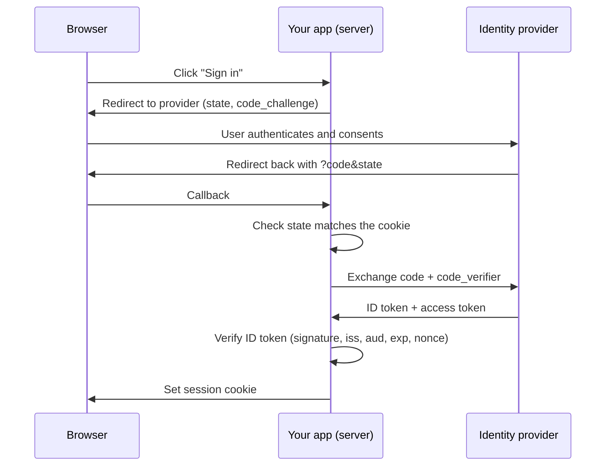

# Authentication in Node.js: Overview

> The vocabulary you need before choosing an auth solution in the JS/TS ecosystem: authentication vs authorization, sessions vs tokens, OAuth 2.0 and OIDC, passkeys and MFA, and the three kinds of solution (library, managed provider, self-hosted identity server).

---

## What is it?

**Authentication** is how an application confirms who a user is; **authorization** is how it decides what that user is allowed to do. In a Node.js or Next.js application, "auth" is the whole chain that makes this work: collecting credentials (password, social login, passkey), verifying them, remembering the verified user across requests (a session or a token), and checking permissions on every request that touches protected data.

Very few teams write that chain from nothing. In practice you pick one of three kinds of solution, each of which takes a different share of the work off your hands:

| Kind | Examples | Where users and credentials live |
|---|---|---|
| **Library** | Auth.js, Better Auth, Passport.js | Your database, your process |
| **Managed provider** (IdP as a service) | Clerk, Auth0, Supabase Auth, Firebase Auth, Cognito, WorkOS | The vendor's infrastructure |
| **Self-hosted identity server** | Keycloak, Zitadel, Ory, Authentik | A separate service you operate |

---

## Why does it matter?

Authentication is the front door of almost every application, and it is unforgiving: one mistake (a token that is decoded but never verified, a session that is not rotated after login, an open redirect in the callback) hands attackers other users' accounts. Broken access control and authentication failures sit at the top of the OWASP Top 10 for this reason.

It is also a domain with a large hidden surface. Login is easy to demo; password reset, email verification, rate limiting, account linking, MFA recovery, session revocation, SSO for enterprise customers, and audit logs are where the effort goes. Knowing the vocabulary below is what lets you compare solutions by what they actually cover instead of by their login screen.

---

## How it works

### Authentication vs authorization

- **Authentication (authn)** — "who is this?" Produces an identity (a user ID, plus claims such as roles or tenant).
- **Authorization (authz)** — "may this identity do this, to this resource?" Runs on every protected operation, close to the data.

Auth frameworks focus on authn. Most offer only basic authz helpers (roles, organization membership). Fine-grained authorization models (RBAC, ABAC, relationship-based) are a separate concern and usually live in your domain code or a dedicated policy engine.

### Remembering the user: sessions vs tokens

After credentials are verified, the server issues something the client presents on later requests.

| | Stateful session | Stateless token (JWT) |
|---|---|---|
| What the client holds | Random opaque ID | Signed, self-describing token |
| Where the truth lives | Session row in a database or cache | Inside the token, until it expires |
| Revocation | Delete the row — immediate | Hard: wait for expiry, or keep a denylist (which reintroduces state) |
| Cost per request | One lookup | Signature check, no lookup |
| Typical use | First-party web apps | Service-to-service calls, APIs consumed by third parties, edge checks |

For a first-party web application, a database-backed session in a cookie is the simpler and safer default. JWTs earn their place when many independent services must verify identity without sharing a store. Several libraries offer both modes (Auth.js defaults to an encrypted JWT cookie when no database adapter is configured).

### Where the client keeps it

- **`HttpOnly` cookie** — not readable by JavaScript, so an XSS bug cannot exfiltrate it. Needs CSRF protection (`SameSite`, plus an `Origin` check on mutations).
- **`localStorage` / JS memory** — immune to CSRF, but any XSS can read and steal the token.

For browser apps, including React SPAs that talk to their own backend, prefer `HttpOnly`, `Secure`, `SameSite=Lax` cookies. A "backend for frontend" (BFF) keeps OAuth tokens on the server and gives the browser only a session cookie.

### OAuth 2.0 and OpenID Connect

- **OAuth 2.0** is a delegation protocol: it lets an app obtain an **access token** to call an API on a user's behalf. On its own it does not say who the user is.
- **OpenID Connect (OIDC)** adds an identity layer on top: an **ID token** (a JWT) that states who signed in, to which client, and when.

"Sign in with Google/GitHub" and enterprise SSO are OIDC (or SAML for older enterprise IdPs). The flow to use for web and mobile apps is **Authorization Code with PKCE**:



`state` blocks login CSRF, PKCE blocks stolen authorization codes, and verifying `iss`/`aud`/`exp` stops tokens issued for another app from being accepted. Skipping any of these is a recurring source of CVEs (see [Known Vulnerabilities](known-vulnerabilities.md)).

### Passwordless, passkeys, and MFA

- **Passkeys (WebAuthn/FIDO2)** — a key pair bound to the site's origin and stored in the device or password manager. Phishing-resistant by design, and the strongest mainstream option today.
- **Magic links / one-time codes by email** — no password to leak, but only as secure as the user's mailbox.
- **MFA factors**, from strongest to weakest: hardware keys and passkeys → authenticator app (TOTP) → push approvals → SMS codes. SMS is vulnerable to SIM swapping and interception; offer it only as a fallback.

### What each kind of solution leaves to you

```
                         Library      Managed provider   Self-hosted IdP
Credential storage       you          vendor             you (in the IdP)
Login / signup UI        you*         vendor (prebuilt)  IdP (themeable)
Emails (verify, reset)   you          vendor             IdP
MFA / passkeys           plugin/you   vendor             IdP
Enterprise SSO / SCIM    rarely       vendor (paid tier) IdP
Uptime and patching      your app     vendor             you (extra service)
Authorization in app     you          you                you
* some libraries ship UI helpers; most expect your own forms
```

Authorization in your own code is the constant: no option removes the need to check permissions next to the data.

---

## Examples

The check that every option still requires — an authorization guard in your own data layer, independent of which auth solution produced the session:

```ts
// lib/invoices.ts — authorize next to the data, whatever issued the session
type Session = { userId: string; tenantId: string; roles: string[] };

export async function getInvoice(session: Session | null, invoiceId: string) {
  if (!session) throw new Error("UNAUTHENTICATED"); // authn: who are you?

  const invoice = await db.invoice.findUnique({ where: { id: invoiceId } });
  if (!invoice || invoice.tenantId !== session.tenantId) {
    throw new Error("NOT_FOUND"); // authz: same answer as "missing", to avoid leaking existence
  }
  return invoice;
}
```

---

## When to use

- Use this article as the map before reading [Build vs Buy](build-vs-buy.md) and the comparison articles.
- Default to database-backed sessions in `HttpOnly` cookies for first-party web apps.
- Use OIDC Authorization Code + PKCE for any social or enterprise login.
- Offer passkeys or TOTP as MFA; keep SMS as a fallback only.

## When NOT to use

- Do not treat authentication as authorization — a signed-in user is not automatically allowed to read every record.
- Do not store long-lived tokens in `localStorage` when a cookie-based session would do.
- Do not use OAuth access tokens as proof of identity; use the OIDC ID token or the provider's userinfo endpoint.
- Do not pick JWTs for a single web app just because they are popular — you will rebuild revocation on top of them.

---

## References

- [OWASP — Authentication Cheat Sheet](https://cheatsheetseries.owasp.org/cheatsheets/Authentication_Cheat_Sheet.html)
- [OWASP — Session Management Cheat Sheet](https://cheatsheetseries.owasp.org/cheatsheets/Session_Management_Cheat_Sheet.html)
- [OWASP Top 10](https://owasp.org/www-project-top-ten/)
- [OAuth 2.0 Security Best Current Practice (RFC 9700)](https://www.rfc-editor.org/rfc/rfc9700)
- [OpenID Connect Core 1.0](https://openid.net/specs/openid-connect-core-1_0.html)
- [passkeys.dev — developer resources for passkeys](https://passkeys.dev/)
- [Pilcrow's Auth Book — a general guideline on implementing auth](https://auth.pilcrowonpaper.com/)
