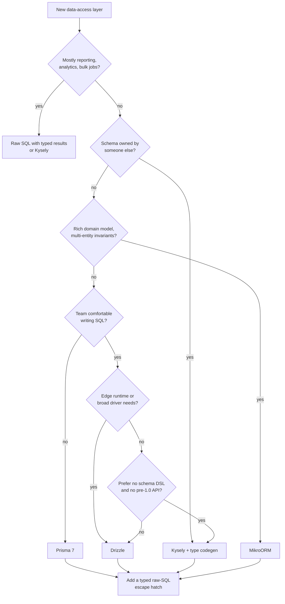

# Choosing a Data Access Tool for Node.js

> How to choose between Prisma, Drizzle, Kysely, TypeORM, MikroORM, and raw SQL for a Node.js or TypeScript project. Covers the criteria that actually decide it, a decision flow, a comparison matrix, and the cases where the right answer is "no ORM".

---

## What is it?

This is the decision guide for the [ORMs and Data Access](README.md) subsection. It turns the [overview](overview.md) and the per-tool articles into a repeatable way to pick a tool for a specific project. The output is one primary tool, one escape hatch, and a written reason for both.

> Versions and status referenced here were checked in **October 2026**. See each tool's article for details and sources.

---

## Why does it matter?

The data-access tool touches every feature, shapes the schema workflow, and outlives most other dependency choices. In Node it is also unusually risky:

- **No safe default by reputation.** The most-downloaded tools include one still at 0.x (Drizzle), one rewriting itself (Prisma 8), and one with one maintainer (MikroORM).
- **Switching is expensive.** Schema definitions, migrations, generated types, and query code all depend on the tool.
- **The wrong level of abstraction costs either way.** Too much, and the team fights generated SQL and N+1. Too little, and hand-written mapping and untyped rows spread through the code.

A short, explicit decision avoids picking by habit or hype.

---

## How it works

### The criteria that actually decide it

1. **Who owns the schema?**
   - *The application* (greenfield) → schema-in-code tools fit: Drizzle (TS), Prisma (PSL), MikroORM/TypeORM (entities).
   - *Someone else* (legacy DB, DBA-managed, shared with other services) → generate types from the database: Kysely + codegen, or typed SQL. Introspection in Prisma/Drizzle works, but keeping two sources of truth in sync is a chore.
2. **How SQL-literate is the team?**
   - Comfortable with SQL → Kysely or Drizzle; the API *is* SQL.
   - Mixed or junior → Prisma's relation-oriented API is the gentlest; MikroORM for those coming from Hibernate/EF/Doctrine.
3. **What do the queries look like?**
   - Mostly CRUD on aggregates → any ORM; Prisma's nested writes and `include` shine.
   - Rich invariants spanning several entities per transaction → MikroORM's Unit of Work.
   - Reporting, CTEs, window functions, bulk updates → Kysely or raw SQL. ORMs only add friction here.
4. **Where does it run?**
   - Long-running Node process → anything.
   - Serverless → small client, small pools, pooler-friendly. Drizzle and Kysely are lightest; Prisma 7 is fine with a driver adapter.
   - Non-Node runtimes (Cloudflare Workers, Deno Deploy) → HTTP/WebSocket drivers. Next.js deprecated `runtime = "edge"` in v16, so on Vercel this mostly no longer applies. Drizzle has the broadest support, Kysely works through community dialects, and Prisma works through driver adapters (still labelled Preview in its docs). TypeORM and Sequelize are not options. See [Serverless and Edge](../../../frameworks/nextjs/orms/serverless-and-edge.md).
5. **How much risk can you absorb?**
   - Pre-1.0 APIs (Drizzle), frequent majors (Prisma 6→7→8), single-maintainer projects (MikroORM, Objection), or slow-moving ones (Sequelize). Each risk is acceptable if it is known and contained behind a repository boundary.
6. **Which framework conventions apply?**
   - NestJS has first-party modules for TypeORM and community/official ones for MikroORM, Prisma, and Drizzle. Convention matters less than the five criteria above, but it lowers onboarding cost.

### Decision flow



Existing codebases are a separate case. Keep TypeORM (upgrade to 1.x) or Prisma where they work, and migrate away from Sequelize, Knex, Objection, Bookshelf, or Waterline incrementally ([Legacy and Declining Tools](legacy-and-declining.md)).

### Comparison matrix

| | Prisma 7 | Drizzle 0.45 / 1.0 RC | Kysely 0.29 | TypeORM 1.x | MikroORM 7 | Raw SQL (`pg`/`postgres`) |
|---|---|---|---|---|---|---|
| Kind | Schema-first ORM | SQL-like ORM | Query builder | Decorator ORM (AR + DM) | Data Mapper + UoW | Driver |
| Schema source | `schema.prisma` (PSL) | TypeScript | DB (codegen) or hand-written types | Entity classes | `defineEntity` / decorators | The database |
| Codegen step | Yes (`prisma generate`) | No | Optional (types) | No | Optional (`compile` for edge) | Optional (PgTyped/sqlc) |
| Result types follow the query | Yes (`select`/`include`) | Yes | Yes | Partial (relations/QueryBuilder weak) | Yes (`Loaded<T>`) | Manual or generated |
| SQL predictability | Medium | High | Very high | Medium | Medium | Total |
| Relations | Declarative, nested writes | Relational queries API | Manual / JSON helpers | Declarative, lazy/eager | Declarative, `Ref`/`Collection` | Manual |
| Unit of Work | No | No | No | No (save per call) | Yes | No |
| Migrations | Prisma Migrate (diff, SQL files) | drizzle-kit (diff, SQL files) | Hand-written `Migrator` | Generated from entities | Generated from metadata | External tool |
| Complex SQL (CTE, window) | `$queryRaw` / TypedSQL (Preview) | `sql` template, partial builder support | Strong | QueryBuilder / raw | Kysely via `getKysely()` | Native |
| Non-Node runtimes (Workers) | Driver adapters (Preview) | Broadest | Community dialects | No | Possible (compiled) | `postgres.js`, HTTP drivers |
| Main risk | Churn (7→8), lock-in to PSL | Still 0.x; breaking RCs | Two maintainers; no schema diffing | Legacy design, type gaps | Bus factor ≈1 | Hand-written mapping and types |
| Best for | CRUD apps, mixed teams | SQL-literate teams, serverless/edge | DB-first, complex queries | Existing NestJS apps | Rich domains | Reports, bulk, hot paths |

### When the answer is "no ORM"

Skip the ORM (use raw SQL with a driver, plus typed results) when:

- The service is mainly **reporting, analytics, ETL, or batch processing** — set-based SQL is the product.
- The schema is **small and stable** and a handful of queries cover the service. A repository with a dozen parameterized queries is simpler than any tool.
- You need **database-specific features** heavily: `LISTEN/NOTIFY`, `COPY`, advisory locks, partitioning, PostGIS, full-text search.
- **Performance is the requirement** and every query will be tuned by hand anyway.

Even then, use a migration tool, parameterize everything, validate or generate result types, and keep SQL in one module. See [Raw SQL](raw-sql.md).

### Write the decision down

A short decision record makes the choice reviewable and revisitable:

```
Decision: Drizzle (primary) + typed raw SQL via sql`` (escape hatch)
Context:  greenfield service, Postgres, SQL-literate team, deployed on serverless
Accepted risks: Drizzle is pre-1.0 — pin versions, budget the 1.0 migration
Boundary: all data access in src/**/repository.ts; no drizzle imports elsewhere
Revisit when: Drizzle 1.0 GA, or if relational queries become the majority
```

---

## Examples

**Scenario 1 — B2B SaaS, greenfield, Postgres, small team of strong backend engineers, deploys to containers.**
Drizzle or Kysely. Drizzle if the team wants schema-in-TS and generated migrations; Kysely + a migration tool (Kysely's `Migrator`, node-pg-migrate, or dbmate) if they want zero schema DSL and no pre-1.0 exposure.

**Scenario 2 — Internal CRUD platform, many contributors with mixed SQL skills, Next.js on Vercel.**
Prisma 7 with the `pg` or Neon driver adapter. Use `select` everywhere, keep TypedSQL or `$queryRaw` for reports, and plan the Prisma 8 upgrade window.

**Scenario 3 — Order management with complex business rules (pricing, inventory reservations, state machines) inside single transactions.**
MikroORM. The Unit of Work collects changes to several aggregates and flushes them in one ordered transaction. Mitigate the single-maintainer risk with a strict repository boundary.

**Scenario 4 — Reading from a 15-year-old database owned by another team.**
Kysely with types generated from the database (`kysely-codegen` or `kanel`), regenerated in CI. No schema DSL to drift from reality.

**Scenario 5 — Existing NestJS monolith on TypeORM 0.3 with Sequelize in an older module.**
Upgrade TypeORM to 1.x with the official codemod. Move the Sequelize module behind a repository interface and reimplement it on TypeORM or Kysely over the same pool. Do not rewrite the TypeORM code.

**A minimal escape hatch next to the primary tool** (Drizzle + typed raw SQL validated with Zod):

```ts
import { sql } from "drizzle-orm";
import { z } from "zod";

const MonthlyRevenue = z.object({ month: z.string(), revenue: z.coerce.number() });

export async function monthlyRevenue(year: number) {
  const result = await db.execute(sql`
    SELECT to_char(date_trunc('month', created_at), 'YYYY-MM') AS month,
           sum(total) AS revenue
      FROM orders
     WHERE status = 'paid' AND extract(year FROM created_at) = ${year}
     GROUP BY 1 ORDER BY 1`);
  return z.array(MonthlyRevenue).parse(result.rows);
}
```

---

## When to use

- When starting a new Node/TS service or a Next.js app that owns a database.
- When an existing tool hits a trajectory change (major rewrite, deprecation, maintainer loss) and you must decide whether to upgrade, migrate, or contain.
- When a team disagrees about "ORM vs SQL". The criteria give the discussion a structure.
- When onboarding a reviewer to a data-access design. The matrix and decision record explain the choice faster than the code.

## When NOT to use

- Do not run this process for a throwaway prototype. Use whatever the team knows and accept the rewrite.
- Do not re-decide for every new service in an organization that already standardized on a tool that works. Consistency has value; deviate only for a concrete constraint (edge runtime, foreign schema).
- Do not treat the matrix as a scorecard to sum. One criterion (schema ownership, runtime) often decides alone.
- Do not choose on benchmarks alone. Vendor benchmarks measure the happy path; query design and N+1 dominate real performance.

---

## References

- [Prisma — Comparing Prisma ORM with other ORMs](https://www.prisma.io/docs/orm/more/comparisons)
- [Drizzle — Why Drizzle](https://orm.drizzle.team/docs/overview)
- [Kysely — Introduction](https://kysely.dev/docs/intro)
- [TypeORM — Documentation](https://typeorm.io/)
- [MikroORM — Documentation](https://mikro-orm.io/docs/quick-start)
- [NestJS — Database](https://docs.nestjs.com/techniques/database)
- [Michael Nygard — Documenting Architecture Decisions](https://cognitect.com/blog/2011/11/15/documenting-architecture-decisions)
