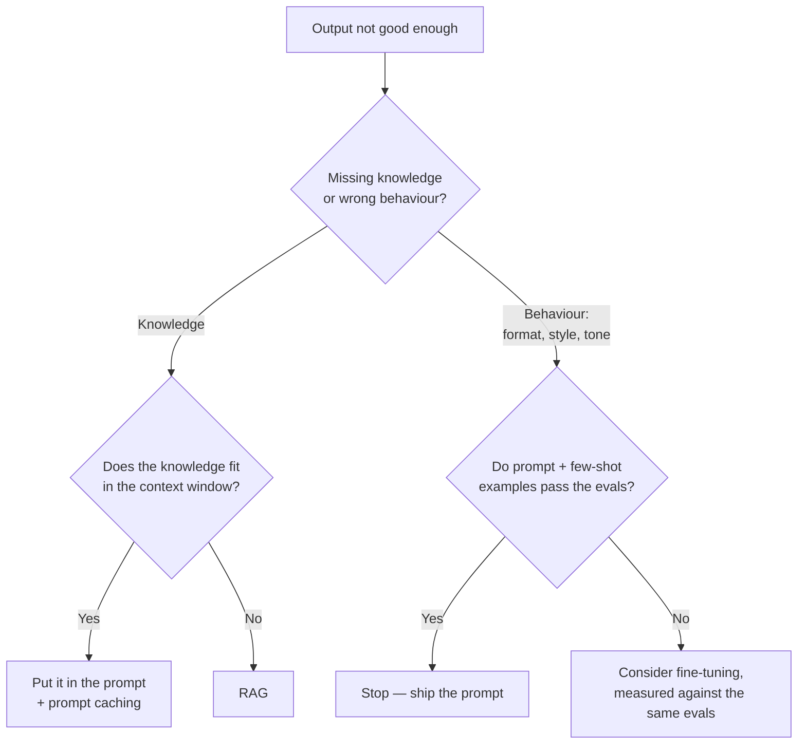

# Prompting vs RAG vs Fine-Tuning

> Missing knowledge is fixed by changing what the model sees; wrong behaviour is fixed by prompting first and fine-tuning only when an eval proves the prompt is not enough.

---

## What is it?

When a language model gives answers that are not good enough, there are three broad ways to improve it: tell it better (prompting), show it the right information at the moment it answers (RAG), or retrain it on examples so it behaves differently by default (fine-tuning). This article is about choosing between them.

The classic mistake is using fine-tuning to *add knowledge* — training on the company wiki so the model "knows" it. Fine-tuning is a tool for *behaviour*: format, style, tone, and narrow repetitive tasks. Knowledge belongs in the context, either pasted in or retrieved.

---

## Why does it matter?

The three options differ by orders of magnitude in cost, speed of change, and risk. Picking the wrong one wastes weeks and can make the system worse:

- **Fine-tuning on facts produces confident hallucinations.** Research on fine-tuning with new knowledge found that models learn new facts slowly and that, as they do, their tendency to hallucinate grows. A comparison of knowledge-injection methods found RAG consistently beat unsupervised fine-tuning, for both known and new facts.
- **Facts change; weights do not.** A fine-tuned model is a snapshot. Every policy update means a new training run, a new eval, a new deployment.
- **Prompting is reversible in seconds.** Most "the model can't do X" problems are "the model was not told X clearly" problems — the cheapest lever, and the one to exhaust first (see the ladder in the [Overview](overview.md)).

---

## How it works

### What each approach changes

- **Prompting / context engineering** changes **what the model sees on this call**: instructions, examples, and any documents small enough to include. Cheap, instant, reversible. See [Prompt Engineering](prompt-engineering.md) and [Context Engineering](context-engineering.md).
- **RAG** also changes what the model sees, but **chooses it dynamically** from a base too large to include whole. Knowledge stays fresh (re-index a document and the next answer uses it) and citable. See [RAG](rag.md).
- **Fine-tuning** changes **the weights**. It is good at teaching a consistent output format, a house style or tone, and narrow, high-volume tasks (classification, extraction into a fixed shape). It is weak at teaching new facts, and what it does learn cannot be cited or easily removed.

### Comparison

| | Prompting | RAG | Fine-tuning |
|---|---|---|---|
| **Upfront cost** | Minutes to hours of writing | Days: ingestion, chunking, index, eval set | Weeks: curated dataset, training runs, evals |
| **Per-call cost** | Grows with prompt length (offset by caching) | Retrieval + the retrieved tokens | Lower prompts; hosting or premium per-token price |
| **Time to change** | Edit and redeploy — seconds | Re-index changed documents — minutes | Retrain and re-evaluate — hours to days |
| **Data freshness** | As fresh as what you paste in | As fresh as the index | Frozen at training time |
| **Traceability** | Answer can quote the prompt | Citations to source chunks | None — knowledge is diffused in weights |
| **Data needed** | A few examples | The documents themselves | Hundreds to thousands of high-quality examples |
| **Main risk** | Long prompts get expensive; instructions ignored | Retrieval misses; permission leakage | Hallucinated "facts", regressions, lock-in to one model version |

### Deciding



Two questions do most of the work. **Is the problem what the model knows, or how it behaves?** And **do you have an eval?** Without one, you cannot show that fine-tuning beat the prompt — so you cannot justify it.

### Combinations

- **RAG + prompting** is the default for knowledge-heavy products: retrieval supplies the facts, the prompt supplies the rules and output format.
- **Fine-tuning + RAG** fits a specialised output format over knowledge that changes: the fine-tuned model reliably produces, say, a regulatory report structure, while RAG feeds it this quarter's data. Train on examples that *include* retrieved context, so the model learns to use it rather than memorise it.

### Distillation

**Distillation** fine-tunes a small model on the outputs of a large one. The large model, well prompted, defines the target behaviour; the small model learns to imitate it on your narrow task and then serves it faster and cheaper. It is a cost and latency lever for high, stable volume — not a quality lever — and it inherits every flaw of the teacher's outputs. See [Cost and Latency Optimization](cost-and-latency-optimization.md) for cheaper options to try first (model routing, caching, batching).

---

## Examples

One problem, three ways: *answer developer questions in the docs base's style (one-line summary, then a short list), using the docs base's knowledge.*

### 1. Prompting with few-shot examples

Style comes from instructions plus two examples of the house format. This handles behaviour well; knowledge is limited to what the model already knows.

**Python — Claude API**

```python
import anthropic

client = anthropic.Anthropic()  # reads ANTHROPIC_API_KEY from the environment

SYSTEM = """You answer questions for an engineering wiki.
Format: a one-sentence summary in bold, then at most three bullets. No preamble.

<examples>
<example>
<question>What is a git worktree?</question>
<answer>**A second working directory attached to the same repository.**
- Check out another branch without stashing.
- Shares objects and history with the main checkout.</answer>
</example>
<example>
<question>What is YAGNI?</question>
<answer>**Do not build a feature until you actually need it.**
- Speculative code costs maintenance now for value that may never come.</answer>
</example>
</examples>"""

response = client.messages.create(
    model="claude-sonnet-5-5",  # model IDs at time of writing
    max_tokens=512,
    system=SYSTEM,
    messages=[{"role": "user", "content": "What is the decorator pattern?"}],
)
print(next(b.text for b in response.content if b.type == "text"))
```

**TypeScript — Claude API**

```typescript
import Anthropic from "@anthropic-ai/sdk";

const client = new Anthropic(); // reads ANTHROPIC_API_KEY from the environment

const SYSTEM = `You answer questions for an engineering wiki.
Format: a one-sentence summary in bold, then at most three bullets. No preamble.

<examples>
<example>
<question>What is a git worktree?</question>
<answer>**A second working directory attached to the same repository.**
- Check out another branch without stashing.
- Shares objects and history with the main checkout.</answer>
</example>
<example>
<question>What is YAGNI?</question>
<answer>**Do not build a feature until you actually need it.**
- Speculative code costs maintenance now for value that may never come.</answer>
</example>
</examples>`;

const response = await client.messages.create({
  model: "claude-sonnet-5-5", // model IDs at time of writing
  max_tokens: 512,
  system: SYSTEM,
  messages: [{ role: "user", content: "What is the decorator pattern?" }],
});
for (const b of response.content) if (b.type === "text") console.log(b.text);
```

### 2. RAG: the same prompt plus retrieved knowledge

Keep `SYSTEM` from above and add the docs base's own text, retrieved per question. `retrieve` is the function from [How to Build a RAG Pipeline](building-a-rag-pipeline.md); here chunks are wrapped in tags with their source id, the portable alternative to a citations API (see [RAG](rag.md)).

**Python — Claude API**

```python
question = "When should I use the decorator pattern?"
docs = "\n".join(
    f'<document source="{c["source"]}">\n{c["text"]}\n</document>' for c in retrieve(question)[:4]
)
response = client.messages.create(
    model="claude-sonnet-5-5",
    max_tokens=512,
    system=SYSTEM + "\nUse only the documents provided. End with the source ids you used, in brackets.",
    messages=[{"role": "user", "content": f"<documents>\n{docs}\n</documents>\n\n{question}"}],
)
```

**TypeScript — Claude API**

```typescript
const question = "When should I use the decorator pattern?";
const docs = (await retrieve(question))
  .slice(0, 4)
  .map((c) => `<document source="${c.source}">\n${c.text}\n</document>`)
  .join("\n");
const ragResponse = await client.messages.create({
  model: "claude-sonnet-5-5",
  max_tokens: 512,
  system: SYSTEM + "\nUse only the documents provided. End with the source ids you used, in brackets.",
  messages: [{ role: "user", content: `<documents>\n${docs}\n</documents>\n\n${question}` }],
});
```

### 3. Fine-tuning: the training dataset

Fine-tuning would teach the *format* by example instead of by instruction. What you prepare is a dataset of JSONL records — one conversation per line, each ending with the ideal answer. The shape below is the one Amazon Bedrock documents for fine-tuning Claude 3 Haiku; other platforms use similar `messages`-based formats with small differences, so check the target platform's spec.

```jsonl
{"system": "You answer questions for an engineering wiki.", "messages": [{"role": "user", "content": "What is a git worktree?"}, {"role": "assistant", "content": "**A second working directory attached to the same repository.**\n- Check out another branch without stashing.\n- Shares objects and history with the main checkout."}]}
{"system": "You answer questions for an engineering wiki.", "messages": [{"role": "user", "content": "What is YAGNI?"}, {"role": "assistant", "content": "**Do not build a feature until you actually need it.**\n- Speculative code costs maintenance now for value that may never come."}]}
```

Two caveats. First, this teaches *style*; facts in these answers would be memorised without any citation, which is exactly what example 2 avoids. Second, availability: fine-tuning for Claude models is limited and platform-specific — Anthropic's published offering has been Claude 3 Haiku through Amazon Bedrock, not the current frontier models — so check your provider's documentation before planning on it. Open-weight models (for example DeepSeek's) can be fine-tuned directly with your own training stack, at the price of hosting them yourself.

---

## When to use

**Prompting**

- **Always, first.** Every system needs a clear prompt; most behaviour problems end here.
- **The knowledge fits in the context window** — paste it in and cache it instead of building retrieval.
- **Requirements change often** — a prompt edit ships in seconds.

**RAG**

- **The knowledge base is larger than the context window**, or too costly to send on every call.
- **Facts change** and answers must reflect the latest version.
- **Answers must cite sources**, or access to documents differs per user.

**Fine-tuning**

- **A narrow, high-volume task** where prompt + few-shot examples demonstrably plateau below the bar on your evals.
- **A strict output format or style** the model keeps drifting from despite clear instructions and examples.
- **Distillation** — moving a proven, stable task from a large model to a small, cheap one at scale.

## When NOT to use

**Prompting**

- **The knowledge is too large to include** — the prompt grows, cost grows, and relevant facts drown in irrelevant ones. Move to RAG.
- **You are compensating for missing data with ever-longer instructions** — the model cannot reason its way to facts it was never shown.

**RAG**

- **The problem is behaviour, not knowledge** — retrieval does not fix tone, format, or reasoning quality.
- **Everything fits in context**, or the task needs the whole corpus at once (counting, aggregating) — see [RAG](rag.md).

**Fine-tuning**

- **The data changes often.** Every change means retraining; RAG absorbs it with a re-index.
- **No eval proves the gain.** If you cannot show the fine-tuned model beats the best prompt on a held-out set, you are paying for an unmeasured change — build the [eval](evals.md) first.
- **To add knowledge.** New facts learned in fine-tuning surface as confident, uncitable hallucinations.
- **You have not tried prompting and few-shot examples seriously.** That is the cheaper baseline every fine-tune must beat.

---

## References

- [Does Fine-Tuning LLMs on New Knowledge Encourage Hallucinations?](https://arxiv.org/abs/2405.05904) — Gekhman et al. (EMNLP 2024), new facts learned in fine-tuning increase hallucination
- [Fine-Tuning or Retrieval? Comparing Knowledge Injection in LLMs](https://arxiv.org/abs/2312.05934) — Ovadia et al. (2023), RAG consistently outperforms unsupervised fine-tuning for knowledge
- [Retrieval-Augmented Generation for Knowledge-Intensive NLP Tasks](https://arxiv.org/abs/2005.11401) — Lewis et al. (2020), the original RAG paper
- [Prompt engineering overview](https://platform.claude.com/docs/en/build-with-claude/prompt-engineering/overview) — Claude documentation: define success criteria and evals before tuning prompts
- [Fine-tune Claude 3 Haiku in Amazon Bedrock](https://claude.com/blog/fine-tune-claude-3-haiku) — Anthropic, the scope and use cases of Claude fine-tuning
- [Prepare data for fine-tuning your models](https://docs.aws.amazon.com/bedrock/latest/userguide/model-customization-prepare.html) — Amazon Bedrock, the JSONL dataset format shown above
- [Distilling the Knowledge in a Neural Network](https://arxiv.org/abs/1503.02531) — Hinton, Vinyals, Dean (2015), the origin of distillation
