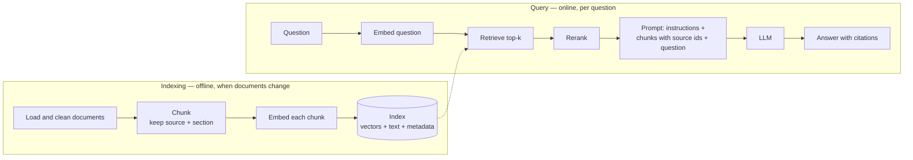

# Retrieval-Augmented Generation (RAG)

> Fetch the few passages of your own documents that answer the question, put them in the prompt, and make the model answer from them — with citations you can check.

---

## What is it?

RAG is a way to let a language model answer questions about documents it has never seen, by looking up the relevant passages first and handing them to the model together with the question. The model does not memorise your data; on every call your code searches a knowledge base, picks the best few pieces, and puts them in the context.

The name comes from the paper that formalised it (Lewis et al., 2020): *retrieval* finds the passages, *augmented* means they are added to the prompt, *generation* is the model writing the answer. Today the term covers any system that grounds a model's answer in text fetched at query time.

---

## Why does it matter?

A model on its own has three problems that RAG addresses directly:

- **Frozen knowledge.** The model knows what was in its training data up to a cutoff. Your release notes from last week, a price change, a new policy — none of it is there.
- **Private data.** Your internal docs, tickets, and wiki were never in the training set and never should be.
- **Hallucination.** Asked about something it does not know, a model tends to produce a fluent, plausible, wrong answer. Grounding the answer in retrieved text, and asking for citations, turns "trust me" into "here is the passage".

The alternatives are worse for this job. Pasting the whole knowledge base into every prompt stops working once it outgrows the context window, and costs more on every call long before that. Fine-tuning changes behaviour, not knowledge — see [Prompting vs RAG vs Fine-Tuning](prompting-vs-rag-vs-fine-tuning.md).

---

## How it works

RAG has two phases that run at different times: **indexing** prepares the knowledge base offline; **query** runs on every question.



**Indexing.** Load the documents, strip noise (navigation, boilerplate, front matter), and split them into **chunks** — pieces small enough to retrieve precisely and large enough to make sense alone. Three chunking strategies, usually combined:

- **By size** — fixed windows of N tokens or characters. Simple; blind to structure.
- **By structure** — split on headings, paragraphs, functions, or table boundaries, so a chunk is a coherent unit.
- **With overlap** — consecutive chunks share a margin so a sentence cut at a boundary still appears whole in one of them.

Every chunk keeps its **metadata**: source document, section, date, and who is allowed to read it. Then each chunk is embedded and stored.

**Query.** Embed the question with the same model, fetch the `k` nearest chunks, optionally rerank them, and build a prompt that contains the instructions, the chunks labelled with their source ids, and the question. The model answers and cites the ids it used.

### Embeddings

An **embedding** is a list of numbers (typically 256–2048 of them) that an embedding model produces for a piece of text, placed so that texts with similar meaning get vectors that point in similar directions. Similarity is measured with **cosine similarity** (or dot product, when the vectors are normalised to length 1). "How do I undo a commit?" and "reverting changes in git" share almost no words but land close together.

Two rules matter in practice: the question and the chunks must be embedded by **the same model**, and many models embed queries and documents slightly differently (an `input_type` parameter), so use the right mode for each. How vectors are stored and searched at scale — ANN indexes, HNSW, pgvector — is covered in [Vector Databases](../databases/types/vector.md).

### Improving retrieval

Most RAG quality problems are retrieval problems. The usual upgrades, roughly in order of payoff:

- **Hybrid search** — run vector search and keyword search (BM25) in parallel and merge the results (for example with reciprocal rank fusion). Embeddings find paraphrases; BM25 finds exact identifiers, error codes, and rare names that embeddings blur.
- **Reranking** — retrieve generously (say, 20–50 candidates), then let a cross-encoder reranker score each candidate against the question and keep the best 3–5. Slower than vector search, much more precise.
- **Contextual retrieval** — before embedding, prefix each chunk with a short, model-generated sentence that situates it in its document ("This section of the Kafka article describes consumer groups…"). Anthropic reports that contextual embeddings plus contextual BM25 cut failed retrievals by 49%, and by 67% with reranking added.
- **Query rewriting** — turn a conversational follow-up ("and for Postgres?") into a standalone query, or split a compound question into several. **HyDE** goes further: the model writes a hypothetical answer, and you embed *that*, because an answer looks more like a document than a question does.

### Variations

- **Agentic RAG** — instead of one fixed retrieval step, the model gets a search tool and decides when to search, what to search for, and whether to search again. The tool can be a plain function ([Tool Use](tool-use.md)) or an MCP server ([Model Context Protocol](model-context-protocol.md)). Better on multi-hop questions; more calls, more cost, less predictable.
- **GraphRAG** — an LLM extracts entities and relationships into a knowledge graph and summarises clusters of it. Useful for "what are the main themes across all these documents?" questions that no single chunk answers.

### How RAG fails

| Failure | What it looks like | Usual fix |
|---|---|---|
| Right chunk not retrieved | Confident "the documents do not say" — or a guess | Hybrid search, contextual retrieval, query rewriting, larger k + reranking |
| Bad chunking | Answer cites half a table, a function without its signature | Chunk by structure; keep tables and code blocks whole; add overlap |
| Too much context | Relevant chunk buried among 30 others; cost climbs | Rerank and cut to the best few — see [Context Engineering](context-engineering.md) |
| Model ignores the source | Answer contradicts the cited passage, or uses training data | Instruct "answer only from the documents", require citations, check faithfulness |
| Permission leakage | A user sees content from a document they cannot open | Filter by access rights **at retrieval time** |

Permission leakage deserves emphasis: once a chunk is in the prompt, the model can repeat it. "Do not reveal documents the user may not see" in the system prompt is not access control. Filter the index query by the caller's permissions so forbidden chunks never reach the model — and treat retrieved text as untrusted input, since a document can carry injected instructions ([Prompt Injection and Guardrails](prompt-injection-and-guardrails.md)).

### Evaluating RAG

Measure the two halves separately, or you cannot tell which one broke:

- **Retrieval** — for a set of questions with known relevant chunks: **recall@k** (did the right chunk appear in the top k?) and **MRR** (mean reciprocal rank: how high did it appear?). Cheap, deterministic, no LLM needed.
- **Generation** — given the retrieved chunks, is the answer **faithful** (every claim supported by a chunk) and does it actually answer the question? Usually graded by an LLM judge.

See [Evals](evals.md) for building the dataset and graders, and [How to Build a RAG Pipeline](building-a-rag-pipeline.md) for a recall@k script.

---

## Examples

The query step only — indexing and the full pipeline are in [How to Build a RAG Pipeline](building-a-rag-pipeline.md). Assume `chunks` (dicts/objects with `id`, `source`, `section`, `text`) and `vectors` (one embedding per chunk) were built at indexing time.

Retrieval needs an embedding model. Anthropic does not offer one; its documentation points to Voyage AI, used here.

**Python — Voyage AI (embeddings)**

```python
import numpy as np
import voyageai

vo = voyageai.Client()  # reads VOYAGE_API_KEY from the environment

def retrieve(question: str, chunks: list[dict], vectors: np.ndarray, k: int = 4) -> list[dict]:
    q = np.array(vo.embed([question], model="voyage-4", input_type="query").embeddings[0])
    scores = vectors @ q / (np.linalg.norm(vectors, axis=1) * np.linalg.norm(q))  # cosine
    return [chunks[i] for i in np.argsort(scores)[::-1][:k]]
```

**TypeScript — Voyage AI (embeddings)**

```typescript
import { VoyageAIClient } from "voyageai";

type Chunk = { id: string; source: string; section: string; text: string };

// environment: the Atlas endpoint, as Voyage's docs instruct for Atlas model API keys
const voyage = new VoyageAIClient({ apiKey: process.env.VOYAGE_API_KEY, environment: "https://ai.mongodb.com/v1" });

const cosine = (a: number[], b: number[]) => {
  let dot = 0, na = 0, nb = 0;
  for (let i = 0; i < a.length; i++) { dot += a[i] * b[i]; na += a[i] ** 2; nb += b[i] ** 2; }
  return dot / (Math.sqrt(na) * Math.sqrt(nb));
};

async function retrieve(question: string, chunks: Chunk[], vectors: number[][], k = 4): Promise<Chunk[]> {
  const res = await voyage.embed({ input: [question], model: "voyage-4", inputType: "query" });
  const q = res.data![0].embedding!;
  return vectors
    .map((v, i) => ({ i, score: cosine(v, q) }))
    .sort((a, b) => b.score - a.score)
    .slice(0, k)
    .map(({ i }) => chunks[i]);
}
```

The retrieved chunks then go into the prompt. In the Claude API, each chunk can be passed as a `document` block with `citations: {enabled: true}`; the response's text blocks then carry `citations` that point back to the exact passage and document title, so the citation cannot reference a source that was not provided. (Citations cannot be combined with structured outputs in the same request.)

**Python — Claude API**

```python
import anthropic

client = anthropic.Anthropic()  # reads ANTHROPIC_API_KEY from the environment

def answer(question: str, retrieved: list[dict]) -> None:
    documents = [
        {
            "type": "document",
            "source": {"type": "text", "media_type": "text/plain", "data": c["text"]},
            "title": f'{c["source"]} — {c["section"]}',
            "citations": {"enabled": True},
        }
        for c in retrieved
    ]
    response = client.messages.create(
        model="claude-sonnet-5-5",  # model IDs at time of writing
        max_tokens=1024,
        system="Answer only from the provided documents. If they do not contain the answer, say so.",
        messages=[{"role": "user", "content": [*documents, {"type": "text", "text": question}]}],
    )
    for block in response.content:
        if block.type == "text":
            print(block.text, end="")
            for cite in block.citations or []:
                if cite.type == "char_location":
                    print(f' [{cite.document_title}: "{cite.cited_text}"]', end="")
```

**TypeScript — Claude API**

```typescript
import Anthropic from "@anthropic-ai/sdk";

const client = new Anthropic(); // reads ANTHROPIC_API_KEY from the environment

async function answer(question: string, retrieved: Chunk[]): Promise<void> {
  const documents = retrieved.map((c) => ({
    type: "document" as const,
    source: { type: "text" as const, media_type: "text/plain" as const, data: c.text },
    title: `${c.source} — ${c.section}`,
    citations: { enabled: true },
  }));
  const response = await client.messages.create({
    model: "claude-sonnet-5-5", // model IDs at time of writing
    max_tokens: 1024,
    system: "Answer only from the provided documents. If they do not contain the answer, say so.",
    messages: [{ role: "user", content: [...documents, { type: "text", text: question }] }],
  });
  for (const block of response.content) {
    if (block.type !== "text") continue;
    process.stdout.write(block.text);
    for (const cite of block.citations ?? []) {
      if (cite.type === "char_location") process.stdout.write(` [${cite.document_title}: "${cite.cited_text}"]`);
    }
  }
}
```

Without a citations feature, the portable pattern is to wrap each chunk in a tag with its id — `<document id="git/worktrees#Steps">…</document>` — and instruct the model to cite ids in square brackets. It works, but nothing guarantees the ids it prints are real; validate them against the ids you sent.

---

## When to use

- **Answers depend on a corpus too large for the context window** — documentation, wikis, ticket history, contracts, codebases.
- **The knowledge changes.** Re-indexing a changed document takes seconds; the model never needs retraining.
- **Answers must be traceable.** Support, legal, compliance, and internal Q&A where a reader needs to click through to the source.
- **Different users may see different data.** Filtering at retrieval time is the natural place to enforce per-user access.
- **You want to reduce hallucination on factual questions** about a defined domain, and can tell the model to say "not in the documents".

## When NOT to use

- **The knowledge base fits in the context.** If everything is a few hundred pages (Anthropic's guidance puts the threshold around 200,000 tokens), put it all in the prompt and use [prompt caching](prompt-caching.md). No index, no retrieval failures.
- **The task needs the whole corpus at once.** "How many tickets mention timeouts?", "summarise every document", "rank all vendors" — top-k retrieval sees a sample, not the population. Use a database query, a batch map-reduce over all documents, or GraphRAG-style global summaries.
- **You want to change style or behaviour.** Tone, format, and domain-specific phrasing come from prompting, few-shot examples, or fine-tuning — not from retrieved facts. See [Prompting vs RAG vs Fine-Tuning](prompting-vs-rag-vs-fine-tuning.md).
- **The data is structured and queryable.** "Orders over 100 last week" is SQL, exposed as a tool, not semantic search over text dumps.
- **You cannot evaluate retrieval.** Without a set of questions and expected sources, you will not know whether a chunking or model change helped or hurt.

---

## References

- [Retrieval-Augmented Generation for Knowledge-Intensive NLP Tasks](https://arxiv.org/abs/2005.11401) — Lewis et al. (NeurIPS 2020), the paper that named and formalised RAG
- [Introducing Contextual Retrieval](https://www.anthropic.com/news/contextual-retrieval) — Anthropic, on contextual embeddings and BM25, reranking, and when to skip RAG entirely
- [Citations](https://platform.claude.com/docs/en/build-with-claude/citations) — Claude API documentation for document blocks with source-backed citations
- [Embeddings](https://platform.claude.com/docs/en/build-with-claude/embeddings) — Claude documentation on embeddings and the Voyage AI models it recommends
- [Precise Zero-Shot Dense Retrieval without Relevance Labels (HyDE)](https://arxiv.org/abs/2212.10496) — Gao et al. (2022), hypothetical document embeddings
- [From Local to Global: A Graph RAG Approach to Query-Focused Summarization](https://arxiv.org/abs/2404.16130) — Edge et al. (2024), the GraphRAG paper
- [LLM08:2025 Vector and Embedding Weaknesses](https://genai.owasp.org/llmrisk/llm082025-vector-and-embedding-weaknesses/) — OWASP, on permission-aware vector stores and cross-tenant leakage
