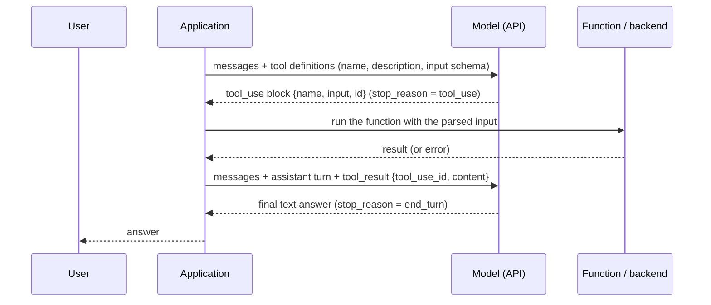

# Tool Use

> Letting a model ask your code to run a function and read the result — the model never executes anything itself, and how well it uses a tool depends mostly on how the tool is designed.

---

## What is it?

Tool use is a way for a language model to get something done outside the text it writes: look up an order, query a database, send a message. You describe a set of functions to the model; when it decides one would help, it replies with a structured request — "call `lookup_order` with `order_id = A-1001`" — instead of a final answer. Your application runs the function and sends the result back, and the model continues from there.

The term **function calling** means the same thing. The key point is in the division of labour: **the model only asks; your code executes.** The model never touches your database or network. It produces JSON that names a tool and its arguments, and everything that actually happens is your code's responsibility — including deciding not to do it.

---

## Why does it matter?

A model on its own is limited to what is in its training data and its context window. Tools remove both limits:

- **Live data.** Prices, stock levels, ticket status, today's weather — anything that changes after training or lives in your systems.
- **Actions.** Creating a ticket, booking a slot, running a query. The model goes from describing what should happen to making it happen.
- **Exact computation.** Arithmetic, date maths, and lookups are cheaper and always correct in code; the model can delegate them instead of guessing.

Tools are also the foundation for everything further up the [ladder of levers](overview.md): [agents](agents.md) are a model calling tools in a loop, [MCP](model-context-protocol.md) is a protocol for packaging tools, and [agent memory](agent-memory.md) is usually exposed as a tool.

The design of the tool matters as much as the model. The same model with a vague, overlapping tool set will call the wrong tool, invent arguments, and burn context on oversized results; with a small, sharply described set it behaves like a careful colleague.

---

## How it works

### The cycle



1. **Define tools.** Each tool has a `name`, a `description`, and a JSON Schema for its input. These are sent with every request and count as input tokens.
2. **The model decides.** If a tool would help, the response contains a `tool_use` block with the tool name, parsed arguments, and an ID.
3. **Your app executes.** Validate the arguments, run the function, catch failures.
4. **Return the result.** Send the assistant turn back unchanged, followed by a user message holding a `tool_result` block that references the same ID.
5. **The model continues** — with a final answer, or another tool call. Repeating steps 2–5 until the model stops asking is the [agent loop](agents.md).

### Parallel calls

A model can request several tools in one response (look up three orders at once). Run them all — in parallel if they are independent — and return **all the results in one user message**, one `tool_result` per `tool_use` ID. Splitting them across several messages breaks the conversation structure and teaches the model to stop batching. In the Claude API, parallel calls are on by default; `disable_parallel_tool_use` limits a turn to one call.

### Controlling whether a tool is called

The `tool_choice` parameter sets the policy:

| Value | Behaviour |
|---|---|
| `auto` (default) | The model decides whether to call a tool or answer directly |
| `none` | Tools are visible but the model must answer in text |
| `any` / a specific tool | Forces a call — **not supported on current Claude models** (Sonnet 5.5, Opus 5.5 return a 400) |

On current models, use `auto` plus an explicit instruction in the prompt ("Use the `lookup_order` tool to answer"), set `strict: true` on the tool so the arguments always match the schema, and check that a `tool_use` block actually came back. If the tool existed only to force JSON out of the model, use [structured outputs](structured-outputs.md) instead.

### Client tools and server tools

- **Client tools** run in your application: you define them (or the provider defines the schema) and you execute every call.
- **Server tools** run on the provider's infrastructure — web search, web fetch, sandboxed code execution. You declare them; the provider executes them and returns results in the same response. Less code for you, less control, and usually an extra per-use charge.

### Designing tools a model uses well

Anthropic's guidance on tool design reduces to one idea: **a tool is an interface for a non-deterministic user**, so design it the way you would write docs for a new colleague who cannot ask follow-up questions.

- **Write the description as documentation.** Say what the tool does, *when to call it*, what it returns, and what it does not do. "Look up an order by ID. Call this whenever the user asks where an order is or when it will arrive." beats "Order tool."
- **Few, well-scoped tools over many overlapping ones.** Do not mirror every REST endpoint. If the model must call `list_users`, `get_user`, and `get_user_orders` to answer one question, build `find_customer_orders` instead. Overlapping tools make the model pick at random.
- **Unambiguous names and parameters.** `order_id` with a format hint, not `id`; an `enum` for fixed sets; namespaced names (`billing_search_invoices`) when several services are present.
- **Lean returns.** Return only what the model needs to take the next step — readable names instead of internal UUIDs, a filtered list instead of the full API payload, pagination or truncation for long results. Every returned token stays in the [context window](context-engineering.md) for the rest of the conversation.
- **Actionable errors.** Return failures as a `tool_result` with `is_error: true` and a message that says what to fix: "No order with ID 'A1001'. IDs look like A-1234." — not a stack trace or `500`. The model reads the message and usually corrects itself on the next call.
- **Validate everything.** Arguments are model output. Check them against the schema, and treat paths, URLs, and query fragments as untrusted (see [Prompt Injection and Guardrails](prompt-injection-and-guardrails.md)). Gate irreversible actions behind human confirmation.

---

## Examples

One fictional tool (`lookup_order`, made-up data) and one full cycle: request → `tool_use` → `tool_result` → final answer. The same function returns an actionable error when the ID is unknown.

**Python — Claude API**

```python
import json
import anthropic

client = anthropic.Anthropic()  # reads ANTHROPIC_API_KEY from the environment

ORDERS = {"A-1001": {"status": "shipped", "carrier": "Parcelo", "eta": "2026-10-24"}}

tools = [{
    "name": "lookup_order",
    "description": (
        "Look up the current status of a customer order. Call this whenever the user "
        "asks whether an order has shipped or when it will arrive. Returns status, "
        "carrier, and estimated delivery date."
    ),
    "strict": True,
    "input_schema": {
        "type": "object",
        "properties": {
            "order_id": {"type": "string", "description": "Order ID as printed on the receipt, e.g. A-1234"},
        },
        "required": ["order_id"],
        "additionalProperties": False,
    },
}]

def lookup_order(order_id: str) -> tuple[str, bool]:
    order = ORDERS.get(order_id)
    if order is None:  # actionable error, not a stack trace
        return f"No order with ID {order_id!r}. IDs look like A-1234; ask the user to check the receipt.", True
    return json.dumps(order), False

messages = [{"role": "user", "content": "Has my order A-1001 shipped yet?"}]
response = client.messages.create(
    model="claude-sonnet-5-5",  # model IDs at time of writing
    max_tokens=1024, tools=tools, messages=messages,
)

if response.stop_reason == "tool_use":
    messages.append({"role": "assistant", "content": response.content})
    results = []
    for block in response.content:
        if block.type == "tool_use":
            content, failed = lookup_order(block.input["order_id"])
            results.append({"type": "tool_result", "tool_use_id": block.id,
                            "content": content, "is_error": failed})
    messages.append({"role": "user", "content": results})  # all results, one message
    response = client.messages.create(
        model="claude-sonnet-5-5", max_tokens=1024, tools=tools, messages=messages,
    )

print(next(b.text for b in response.content if b.type == "text"))
```

**TypeScript — Claude API**

```typescript
import Anthropic from "@anthropic-ai/sdk";

const client = new Anthropic(); // reads ANTHROPIC_API_KEY from the environment

const ORDERS: Record<string, { status: string; carrier: string; eta: string }> = {
  "A-1001": { status: "shipped", carrier: "Parcelo", eta: "2026-10-24" },
};

const tools: Anthropic.Tool[] = [{
  name: "lookup_order",
  description:
    "Look up the current status of a customer order. Call this whenever the user " +
    "asks whether an order has shipped or when it will arrive. Returns status, " +
    "carrier, and estimated delivery date.",
  strict: true,
  input_schema: {
    type: "object",
    properties: {
      order_id: { type: "string", description: "Order ID as printed on the receipt, e.g. A-1234" },
    },
    required: ["order_id"],
    additionalProperties: false,
  },
}];

function lookupOrder(orderId: string): { content: string; failed: boolean } {
  const order = ORDERS[orderId];
  if (!order) { // actionable error, not a stack trace
    return { content: `No order with ID '${orderId}'. IDs look like A-1234; ask the user to check the receipt.`, failed: true };
  }
  return { content: JSON.stringify(order), failed: false };
}

const messages: Anthropic.MessageParam[] = [{ role: "user", content: "Has my order A-1001 shipped yet?" }];
let response = await client.messages.create({
  model: "claude-sonnet-5-5", // model IDs at time of writing
  max_tokens: 1024, tools, messages,
});

if (response.stop_reason === "tool_use") {
  messages.push({ role: "assistant", content: response.content });
  const results: Anthropic.ToolResultBlockParam[] = [];
  for (const block of response.content) {
    if (block.type === "tool_use") {
      const { content, failed } = lookupOrder((block.input as { order_id: string }).order_id);
      results.push({ type: "tool_result", tool_use_id: block.id, content, is_error: failed });
    }
  }
  messages.push({ role: "user", content: results }); // all results, one message
  response = await client.messages.create({ model: "claude-sonnet-5-5", max_tokens: 1024, tools, messages });
}

for (const block of response.content) {
  if (block.type === "text") console.log(block.text);
}
```

Three details carry over to every tool integration: the assistant turn is appended **unchanged** (it holds the `tool_use` blocks the results refer to), every `tool_result` carries the matching `tool_use_id`, and with `auto` the code checks `stop_reason` instead of assuming a call happened. For more than one round trip, see the loop in [Agents](agents.md).

---

## When to use

- **The answer depends on data the model cannot see.** Live state, private records, anything after the training cutoff — and too large or too volatile to paste into the prompt.
- **The task requires an action.** Creating, updating, or sending something in another system.
- **Exactness matters more than fluency.** Calculations, conversions, and lookups where code is always right and the model is only usually right.
- **The model must choose what to fetch.** When which data is needed depends on the conversation, a tool lets the model decide instead of your code pre-fetching everything.

## When NOT to use

- **The information fits in the prompt.** A short, stable reference table belongs in the context; a tool round trip adds latency and tokens for nothing.
- **Deterministic code can decide alone.** If the app always needs the order status before answering, fetch it up front and pass it in. Let the model choose only what genuinely varies.
- **You only need structured output.** A tool used purely to extract JSON is the old workaround; [structured outputs](structured-outputs.md) do it directly.
- **The action is irreversible and unsupervised.** Deleting data, moving money, or messaging customers on the model's say-so without validation and a human checkpoint.
- **Tool sprawl.** Dozens of overlapping tools in one request degrade selection and inflate every call. Consolidate, or load tools on demand.

---

## References

- [Writing effective tools for AI agents](https://www.anthropic.com/engineering/writing-tools-for-agents) — Anthropic, the source for the tool-design principles above: consolidation, namespacing, lean returns, actionable errors
- [Tool use with Claude](https://platform.claude.com/docs/en/agents-and-tools/tool-use/overview) — Claude API documentation: client vs server tools, the round trip, `tool_choice`, and pricing
- [Building effective agents](https://www.anthropic.com/engineering/building-effective-agents) — Anthropic; its appendix "Prompt engineering your tools" covers tool definitions as part of the prompt
