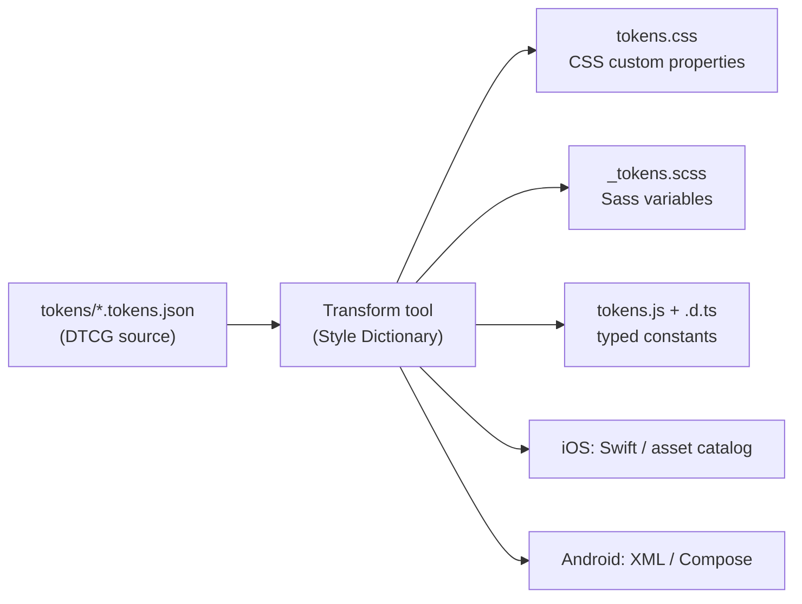

# Design Tokens

> Named design decisions stored once in a platform-neutral format, organised in tiers, and compiled to every platform — the versioned contract between design tools and code.

---

## What is it?

A design token is a named value for a design decision — a color, a spacing step, a font size, a shadow — written down once so that every screen, platform and tool can use the same value by name instead of copying the number. `color.action.bg` is a token; `#2563eb` typed into a stylesheet is not.

[Design System Architecture](../design-system-architecture.md) introduces tokens as the bottom layer of a design system. This article goes one level deeper into the tokens themselves:

- **Tiers** — primitive, semantic and component tokens, and why the middle tier carries the architecture.
- **Format** — the W3C Design Tokens Community Group (DTCG) format as the interchange standard.
- **Pipeline** — how a token source becomes CSS custom properties, Sass, JavaScript and native resources.
- **Lifecycle** — theming, multi-brand, versioning and deprecation of token names.

---

## Why does it matter?

Without tokens, design decisions live as literals scattered across stylesheets, Figma files, iOS asset catalogs and Android resources. The same blue exists in forty places with three slightly different hex codes, and nobody can say which one is right.

Tokens fix three problems at once:

- **Single source of truth** — one file defines `color.brand.500`; every platform output is generated from it, so web, iOS and Android cannot drift.
- **Change at the right altitude** — a rebrand changes primitive values; a dark mode remaps semantic tokens; neither touches component code.
- **A contract between design and engineering** — designers and engineers name the same thing the same way. A design file that says `color.text.muted` and code that reads `var(--color-text-muted)` can be checked against each other mechanically.

The cost is a build step and naming discipline. Both are cheap compared with auditing forty hard-coded blues.

---

## How it works

### Three tiers

Tokens are organised in tiers, each referencing the one below. The tiers answer different questions.

```
  ┌────────────────────────────────────────────────────────────┐
  │ Component tokens   "what does THIS component use?"          │
  │   button.bg  ──► {color.action.bg}                          │  optional, per component
  ├────────────────────────────────────────────────────────────┤
  │ Semantic tokens    "what is this value FOR?"                │
  │   color.action.bg ──► {color.blue.600}   (light theme)      │  the theming surface
  │   color.action.bg ──► {color.blue.400}   (dark theme)       │
  ├────────────────────────────────────────────────────────────┤
  │ Primitive tokens   "what values EXIST?"                     │
  │   color.blue.600 = oklch(…)   space.4 = 1rem                │  the palette; never themed
  └────────────────────────────────────────────────────────────┘
```

- **Primitive** (also called reference, core or global) — the raw palette and scales. Named by *what they are* (`blue.600`, `space.4`). They do not change between themes.
- **Semantic** (also called alias or system) — named by *purpose* (`color.text.muted`, `color.surface.raised`, `space.inset.md`). This is where theming happens: a theme is a different mapping from semantic to primitive.
- **Component** — named by *component and slot* (`button.primary.bg`). Useful when a component needs to diverge from the semantic default or when designers want per-component control; skip this tier until that need is real.

The rule that keeps tiers useful: **components consume semantic (or component) tokens, never primitives.** A component that reads `blue.600` directly cannot be themed, because the theme does not touch primitives.

### The DTCG format

The W3C Design Tokens Community Group publishes a vendor-neutral JSON format so design tools, token managers and build tools can exchange tokens. Its first stable release, **2025.10** (October 2025), is a Final Community Group Report — stable and intended for implementation, but not a W3C Standard. It consists of three modules:

- **Format** — the file structure: tokens as objects with `$value`, `$type`, optional `$description`, `$deprecated` and `$extensions`; groups as nested objects; references between tokens.
- **Color** — structured color values (`colorSpace`, `components`, optional `alpha` and `hex` fallback) rather than bare hex strings.
- **Resolver** — how to combine token sets with *modifiers* (light/dark, brand, density) and a resolution order, so themes are declared instead of duplicated.

Key rules of the Format module:

- **References** use curly braces to point at another token: `"$value": "{color.blue.600}"`. A JSON Pointer form (`$ref`) also exists for property-level access.
- **Types** include `color`, `dimension`, `fontFamily`, `fontWeight`, `duration`, `cubicBezier`, `number`, and composite types (`shadow`, `border`, `typography`, `transition`, `gradient`, `strokeStyle`).
- **`$type` inherits** from the enclosing group, so a `color` group need not repeat it on every token.
- **`$deprecated`** is `true` or a string explaining what to use instead — the format has a built-in deprecation channel.
- Recommended file extensions are `.tokens` or `.tokens.json`.

Tools differ in how completely they implement 2025.10 (especially structured colors and the Resolver); check your toolchain's documentation before relying on a specific feature.

### The transformation pipeline

A token source is not consumed directly. A build tool reads it, resolves references, applies per-platform transforms (units, naming case, color formats) and writes outputs. Style Dictionary (currently 5.x; requires Node.js 22+) is the most widely used open-source option; Tokens Studio, Terrazzo and in-house scripts fill the same role.



Architectural choices in the pipeline:

- **Output references or resolved values.** For CSS, emitting `--color-action-bg: var(--color-blue-600)` preserves the tier structure at runtime (and enables runtime theming); emitting the resolved value is smaller and fully static.
- **Which tiers ship.** Many teams ship primitives *and* semantics to CSS but expose only semantic names in the documented API, so consumers are not tempted to use primitives.
- **Naming transforms are part of the contract.** `color.action.bg` becomes `--color-action-bg`, `$color-action-bg`, `ColorActionBg`. Changing the transform renames every output — a breaking change.

### Theming and multi-brand

Because themes only remap the semantic tier, a theme is a small file — or, with the Resolver module, a modifier context:

```
                    primitives (shared by all)
                              │
          ┌───────────────────┼────────────────────┐
          ▼                   ▼                    ▼
   semantic: light      semantic: dark      semantic: brand-b
          │                   │                    │
          └──────── same semantic NAMES ───────────┘
                              │
                   components (unchanged)
```

Multi-brand adds a second axis (brand × mode). Two practical rules:

- Brands may have **different primitive palettes**, but must expose the **same semantic names**. The semantic layer is the interface; brand palettes are implementations.
- On the web, ship one CSS file per brand-mode combination (or one file with scoped selectors such as `[data-brand="b"][data-theme="dark"]`) and switch at runtime by attribute. Mechanics of custom-property theming are covered in [custom properties and theming](../../../../languages/css/custom-properties-and-theming.md).

### Versioning and deprecation

Token names are a public API. Treat changes the way [Design System Architecture](../design-system-architecture.md) treats component props:

| Change | SemVer impact |
|---|---|
| Add a token | Minor |
| Change a primitive's value (same intent) | Patch or minor — visual, not API |
| Remap a semantic token to a different primitive | Minor, with visual review |
| Rename or remove a token | **Major** |
| Change the naming transform or output format | **Major** |

Deprecate before removing: mark the token with `$deprecated` (with a message naming the replacement), keep emitting it as an alias of the new token for at least one major cycle, and lint consumers for deprecated names (a Stylelint rule or a codemod that rewrites `var(--old)` to `var(--new)`).

### Tokens as the design–code contract

The token source should sit where both disciplines can change it with review — typically a repository (often a `tokens` package in a [monorepo](styling-in-monorepos.md)) synced from the design tool by a plugin that writes DTCG JSON. The pull request is the meeting point: designers propose a remap, engineers see the diff and its effect in visual regression before release.

---

## Examples

A DTCG 2025.10 source split into primitive and semantic tiers. Note the structured color values and the reference syntax:

```json
{
  "color": {
    "$type": "color",
    "blue": {
      "400": { "$value": { "colorSpace": "srgb", "components": [0.376, 0.647, 0.98], "hex": "#60a5fa" } },
      "600": { "$value": { "colorSpace": "srgb", "components": [0.145, 0.388, 0.922], "hex": "#2563eb" } }
    },
    "white": { "$value": { "colorSpace": "srgb", "components": [1, 1, 1], "hex": "#ffffff" } }
  },
  "space": {
    "$type": "dimension",
    "2": { "$value": { "value": 0.5, "unit": "rem" } },
    "4": { "$value": { "value": 1, "unit": "rem" } }
  }
}
```

```json
{
  "color": {
    "$type": "color",
    "action": {
      "bg": { "$value": "{color.blue.600}", "$description": "Primary interactive surface" },
      "fg": { "$value": "{color.white}" }
    },
    "primary": {
      "$value": "{color.blue.600}",
      "$deprecated": "Use color.action.bg instead. Removed in v4."
    }
  }
}
```

A minimal Style Dictionary configuration emitting CSS custom properties that keep references:

```javascript
// style-dictionary.config.mjs
export default {
  source: ["tokens/**/*.tokens.json"],
  platforms: {
    css: {
      transformGroup: "css",
      buildPath: "dist/css/",
      files: [{
        destination: "tokens.css",
        format: "css/variables",
        options: { outputReferences: true },
      }],
    },
  },
};
```

The generated CSS — semantic names pointing at primitives, so a theme can override only the semantic layer:

```css
:root {
  --color-blue-400: #60a5fa;
  --color-blue-600: #2563eb;
  --color-white: #ffffff;
  --space-2: 0.5rem;
  --space-4: 1rem;
  --color-action-bg: var(--color-blue-600);
  --color-action-fg: var(--color-white);
  --color-primary: var(--color-blue-600); /* deprecated: use --color-action-bg */
}

[data-theme="dark"] {
  --color-action-bg: var(--color-blue-400);
}
```

---

## When to use

- More than one platform (web plus native, or several web stacks) must share visual decisions.
- Theming of any kind — dark mode, high contrast, white-label or multi-brand products.
- A design team works in a tool that can export tokens, and you want design changes to arrive as reviewable diffs rather than screenshots.
- Several apps or [micro-frontends](styling-micro-frontends.md) must stay visually consistent without sharing component code.

## When NOT to use

- A single small web app with no theming — a handful of CSS custom properties in one file gives most of the benefit with no pipeline.
- Tokenising everything — a token for every one-off value (`checkout.promo-banner.margin-top`) recreates the literal problem with extra indirection; tokens are for *decisions that repeat*.
- Letting components consume primitives "because it's easier" — it silently disables theming for that component.
- Skipping the semantic tier and theming at the primitive level — redefining `blue.600` to be orange in dark mode makes every name a lie.
- Building a custom token pipeline before trying an existing tool — the transforms, reference resolution and platform formats are solved problems.

---

## References

- Design Tokens Community Group. [Design Tokens Format Module 2025.10](https://www.designtokens.org/TR/2025.10/format/). designtokens.org (also: [Color](https://www.designtokens.org/TR/2025.10/color/) and [Resolver](https://www.designtokens.org/TR/2025.10/resolver/) modules).
- Style Dictionary. [Documentation](https://styledictionary.com/) and [Design Tokens](https://styledictionary.com/info/tokens/). styledictionary.com.
- Curtis, Nathan (EightShapes, design-systems author). [Naming Tokens in Design Systems](https://medium.com/eightshapes-llc/naming-tokens-in-design-systems-9e86c7444676). Medium.
- Frost, Brad (author of *Atomic Design*). [The Many Faces of Themeable Design Systems](https://bradfrost.com/blog/post/the-many-faces-of-themeable-design-systems/). bradfrost.com.
- MDN Web Docs. [Using CSS custom properties](https://developer.mozilla.org/en-US/docs/Web/CSS/Using_CSS_custom_properties).
