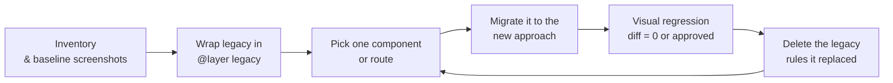

# Evolving and Migrating Styles

> Change a styling codebase the way you change any legacy system — measure first, wall off the old code with cascade layers, migrate one component or route at a time behind visual regression tests, and retire old classes and tokens through an explicit deprecation policy.

---

## What is it?

Every styling codebase eventually needs to change: a preprocessor feature is deprecated, a CSS-in-JS library stops being maintained, the framework moves to server rendering, or years of global CSS have made every change risky. Evolving styles is the practice of making those changes **incrementally and safely**, without a big-bang rewrite and without visual regressions reaching users.

It applies the [strangler fig](https://martinfowler.com/bliki/StranglerFigApplication.html) approach — grow the new system around the old one and remove the old one piece by piece — to CSS, where the cascade adds a complication: old and new styles share one document and can override each other.

---

## Why does it matter?

Styling migrations fail in characteristic ways:

- **The big-bang rewrite** — "we'll move everything to the new approach in one release". It stalls halfway, and the codebase now has two systems with no plan to finish.
- **Invisible breakage** — CSS has no compiler errors. A migrated rule with slightly different specificity or order changes a page nobody looked at, and users find it.
- **No exit for old code** — the new approach is adopted for new components, but nothing ever removes the old global stylesheet, so its rules keep overriding the new ones.
- **Unannounced removals** — a class or token is deleted, and a team in another repository discovers it in production.

Each of these has a structural fix: measurement before change, layers to contain old code, small steps with visual regression, and deprecation as a published policy.

---

## How it works

### 1. Inventory and audit

Before changing anything, find out what exists and what is used:

- **Unused CSS** — browser coverage tools (Chrome DevTools Coverage panel) show which rules ran during a session; build-time tools compare selectors against templates. Treat results as candidates, not proof: rules for states, error pages and rarely visited routes look unused in a short session.
- **Specificity graph** — Harry Roberts' idea: plot the specificity of every selector in source order. A healthy codebase trends upward (generic first, specific last). Spikes are the selectors that force others to escalate; they are the first refactoring targets.
- **Hard-coded values** — count distinct colors, font sizes and spacing values. Forty grays signal the need for [tokens](design-tokens.md) before any tooling migration.
- **`!important` and ID selectors** — count and locate them; each one is an override war waiting to repeat.
- **Ownership** — which team or feature owns which stylesheet. Unowned global files are where migrations stall.

Record the numbers. They are the migration's progress metrics.

### 2. Contain the legacy with cascade layers

Cascade layers let old and new CSS coexist with a deterministic winner. Put all legacy CSS into a low-priority layer and new code into higher ones:

```
   @layer legacy, tokens, base, components, utilities;

   ┌──────────────── priority ───────────────────────────────►
   │ legacy      everything that existed before (any specificity)
   │ tokens      new design tokens
   │ base        new reset/base
   │ components  migrated / new components
   │ utilities   helpers
   └─────────────────────────────────────────────────────────►
```

Because layer order beats specificity, a migrated component with a single class selector wins over a legacy `#main .sidebar ul li a` rule — no need to match or exceed the old specificity. Two cautions:

- **Unlayered CSS beats all layers.** Every legacy file must actually be imported into `legacy`, including third-party CSS; one forgotten file sits above everything.
- **`!important` inverts layer order** — an important declaration in `legacy` beats an important one in `components`. Audit `!important` in legacy code before relying on layers.

Cascade-layer mechanics are covered in [cascade, specificity and inheritance](../../../../languages/css/cascade-specificity-and-inheritance.md); target layering in [CSS Architecture and Organization](css-architecture-and-organization.md).

### 3. Migrate incrementally — per component or per route



- **Unit of migration**: a component (for shared UI) or a route (for page-level CSS). Small enough to review, large enough to delete something.
- **Delete as you go.** A step that adds the new styles but leaves the old rules is not finished; the deletion is what makes progress measurable.
- **New code uses only the new approach** from day one — enforce it with lint rules on new files.
- **Freeze the legacy layer**: no new rules in `legacy`, only deletions.

### 4. Common migrations

**Sass `@import` → `@use`/`@forward`.** Dart Sass deprecated `@import` in 1.80.0; it will be removed in Dart Sass 3.0.0, which the Sass team says will come no sooner than two years after 1.80.0. The module system gives namespaced members and loads each module once. The official `sass-migrator` tool rewrites files automatically (`sass-migrator module --migrate-deps <entrypoint>`); it also migrates deprecated global built-in functions to their module equivalents. Run it per entry point, review the diff, then compile and compare output CSS.

**Runtime CSS-in-JS → zero-runtime CSS-in-JS or CSS Modules.** Usually triggered by a move to server components or streaming (see [Styling and Rendering Strategies](styling-and-rendering-strategies.md)), or by the library's maintenance status — styled-components entered maintenance mode in March 2025. Migrate leaf components first (no styled children), then containers. Map the theme object to CSS custom properties early: once theme values are custom properties, both old and new components read the same source, and dynamic per-prop styles become `data-*` attributes or custom properties set inline. Mechanics: [CSS-in-JS](../../../../languages/css/css-in-js.md), [CSS Modules and scoped styles](../../../../languages/css/css-modules-and-scoped-styles.md).

**Legacy global CSS → layered architecture.** Wrap everything in `@layer legacy` (step 2), add the new layer order, then extract components one by one into colocated, scoped styles.

**Preprocessor features → native CSS.** Variables become custom properties (with the bonus of runtime theming); nesting is native CSS (Baseline since late 2023); color functions have native counterparts (`color-mix()`, relative color syntax). Keep Sass where it still adds value — mixins, loops, build-time maps — and drop it where it only provides what CSS now does. See [modern CSS](../../../../languages/css/modern-css.md) and [Sass](../../../../languages/css/sass.md).

**Adopting tokens.** Replace literals with semantic tokens in waves: first introduce tokens with values equal to the most common existing literals (no visual change), then codemod literals to tokens, then consolidate near-duplicates (the forty grays) as a separate, visually reviewed step. Mixing "replace literal with token" and "change the value" in one step makes every diff ambiguous.

### 5. Codemods

Mechanical changes belong to tools, not hands:

- **Stylesheets** — PostCSS plugins or scripts over the CSS AST for renames (`var(--old)` → `var(--new)`), unit changes and selector rewrites; `sass-migrator` for Sass.
- **Component code** — jscodeshift or ast-grep for class-name and import rewrites, CSS-in-JS to CSS Modules scaffolding, prop renames.
- **Guardrails** — Stylelint rules (disallowed properties, values, selectors, custom-property patterns) that fail CI when deprecated patterns reappear.

A codemod is finished when it is idempotent, runs in CI on the whole repository, and its output passes visual regression.

### 6. Visual regression as the safety net

CSS has no type checker; screenshots are the closest substitute:

- **Component level** — screenshots of every component state from the component catalog (Storybook with Chromatic, or Playwright `toHaveScreenshot` against a story page).
- **Page level** — key routes in a few viewport widths and themes.
- **Baseline before the first change**, so every migration step is diffed against reality, not memory.
- **Deterministic rendering** — fixed fonts, disabled animations, stable data — or false positives will teach the team to approve diffs without looking.

In a monorepo, run only the screenshots affected by the change (see [Monorepo CI](../../repository-organization/monorepo-ci.md) and [Styling in Monorepos](styling-in-monorepos.md)).

### 7. Deprecation policy for classes and tokens

Class names and token names are public API whenever anything outside the owning component uses them. Publish a policy and follow it:

1. **Announce** — mark as deprecated where consumers see it: `$deprecated` in the token source, a comment and changelog entry for classes, a Stylelint rule that warns.
2. **Alias** — keep the old name working, implemented in terms of the new one (`--color-primary: var(--color-action-bg)`).
3. **Measure** — search all consuming repositories for remaining uses; a codemod should exist for every deprecation.
4. **Escalate** — warning becomes error in lint after a fixed window.
5. **Remove** — in a major release, after usage reaches zero.

### Trend signals

Surveys such as State of CSS (stateofcss.com) are useful to see which features and tools are gaining or losing adoption, and therefore which migrations are likely to come up. Treat them as a trend signal, not as a reason to migrate: the trigger should be a concrete problem in your codebase.

---

## Examples

Containing legacy CSS during a migration — every old file in one low layer, third-party CSS included:

```css
/* src/styles/index.css */
@layer legacy, tokens, base, components, utilities;

@import url("./legacy/main.css") layer(legacy);
@import url("./legacy/forms.css") layer(legacy);
@import url("old-carousel/dist/carousel.css") layer(legacy);

@import url("./tokens.css") layer(tokens);
@import url("./base.css") layer(base);
```

Sass module migration, before and after `sass-migrator module`:

```scss
// Before — global namespace, loaded as many times as imported
@import "variables";
@import "mixins";

.card {
  padding: $space-4;
  @include elevated;
}
```

```scss
// After — namespaced, loaded once
@use "variables" as vars;
@use "mixins";

.card {
  padding: vars.$space-4;
  @include mixins.elevated;
}
```

Preprocessor features replaced by native CSS:

```css
/* Native nesting and custom properties — no build step required */
.card {
  --card-padding: var(--space-4);
  padding: var(--card-padding);

  & .card__title {
    color: color-mix(in oklch, var(--color-text) 80%, transparent);
  }

  &:hover {
    box-shadow: var(--shadow-raised);
  }
}
```

Deprecated token kept as an alias, with a lint rule that flags its use:

```css
:root {
  --color-action-bg: oklch(0.55 0.18 250);
  /* @deprecated since v3.4 — use --color-action-bg. Removed in v4.0. */
  --color-primary: var(--color-action-bg);
}
```

```json
{
  "rules": {
    "declaration-property-value-disallowed-list": {
      "/.*/": ["/var\\(--color-primary\\)/"]
    }
  }
}
```

---

## When to use

- A styling dependency is deprecated or unmaintained (Sass `@import`, a runtime CSS-in-JS library).
- The rendering strategy changes (to SSR, streaming or server components) and the current styling approach does not fit it.
- Changes to global CSS routinely break unrelated pages, or `!important` and long selectors keep growing.
- Introducing design tokens or a design system into an existing product.

## When NOT to use

- **Migrating because a tool is fashionable** — a survey trend or a conference talk is not a problem in your codebase; migrations cost months.
- **A big-bang rewrite of all styles** — it stalls, leaves two systems, and has no safe rollback; migrate per component or route.
- **Migrating without visual regression** — CSS changes fail silently; without screenshots you are shipping blind.
- **Adding new code to the legacy layer** "just this once" — the layer only shrinks if it is frozen.
- **Removing classes or tokens without a deprecation window** when other teams or repositories consume them.
- **A small, stable codebase that works** — if nobody fights the CSS, the migration's cost has no return.

---

## References

- Sass. [Breaking change: `@import` and global built-in functions](https://sass-lang.com/documentation/breaking-changes/import/) and [Migrator](https://sass-lang.com/documentation/cli/migrator/). sass-lang.com.
- MDN Web Docs. [Cascade layers](https://developer.mozilla.org/en-US/docs/Learn_web_development/Core/Styling_basics/Cascade_layers) and [CSS nesting](https://developer.mozilla.org/en-US/docs/Web/CSS/CSS_nesting).
- Roberts, Harry. [The Specificity Graph](https://csswizardry.com/2014/10/the-specificity-graph/). CSS Wizardry.
- Fowler, Martin. [Strangler Fig Application](https://martinfowler.com/bliki/StranglerFigApplication.html). martinfowler.com.
- Chrome for Developers. [Coverage: find unused JavaScript and CSS](https://developer.chrome.com/docs/devtools/coverage).
- Playwright. [Visual comparisons](https://playwright.dev/docs/test-snapshots). playwright.dev.
- Stylelint. [Documentation](https://stylelint.io/).
- Devographics. [State of CSS](https://stateofcss.com/) — annual developer survey; trend signal only.
