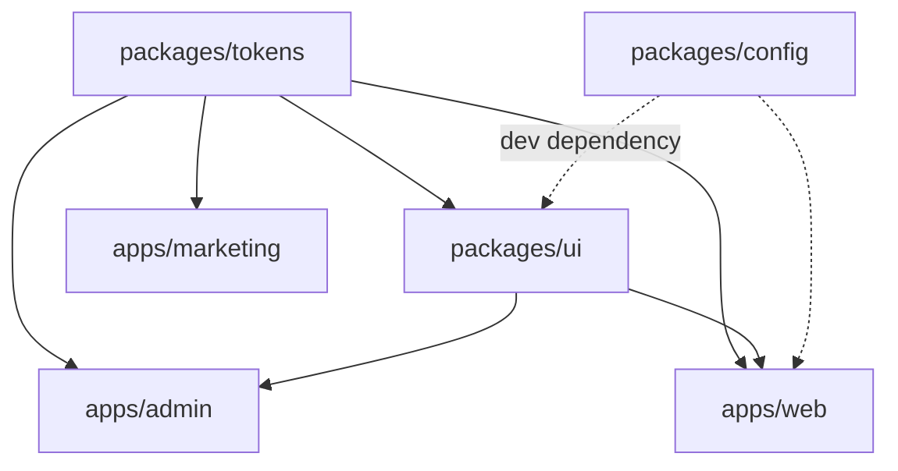

# Styling in Monorepos

> Put tokens and UI components in shared workspace packages, decide deliberately whether they ship compiled CSS or source, and use `@layer` so cross-package CSS order is decided by declaration rather than by the bundler.

---

## What is it?

Styling in a monorepo is the problem of sharing visual decisions and styled components between several applications that live in one repository — a marketing site, a web app and an admin panel, say — without each app copying styles or depending on the others.

The general mechanics of a monorepo (workspace layer, internal dependency graph, one-version rule, ownership) are in [Inside a Monorepo](../../repository-organization/inside-a-monorepo.md). This article covers what is specific to CSS:

- How to split styling into packages (`tokens`, `ui`, optional `config`).
- What those packages should *emit* — compiled CSS, source CSS/Sass, or styles that need the consumer's build.
- How to share a Tailwind theme.
- How to make CSS order deterministic when stylesheets come from several packages.
- How to version, build and test styling packages without rebuilding everything.

---

## Why does it matter?

Styles are the easiest thing to share badly. Common failures in multi-app repositories:

- **Copy-paste drift** — each app has its own `variables.css`; after a year the "same" brand color has three values.
- **Hidden build coupling** — `apps/web` imports `../../packages/ui/src/button.scss` by relative path, so the UI package can never change its internals or build step without breaking an app.
- **Order roulette** — the shared button's CSS and an app's override have equal specificity; which one wins depends on import order inside each app's bundle, so the same component looks different in two apps.
- **Everything rebuilds** — a token change triggers every app's build and every visual test, because nothing models which apps actually consume which styling package.

The monorepo makes sharing cheap, which makes these failures cheap to create. The architecture below makes them cheap to avoid.

---

## How it works

### Package layout

A typical split, with the dependency graph pointing one way:

```
  repo/
    packages/
      tokens/        DTCG source → dist/tokens.css, dist/tokens.js, _tokens.scss
      ui/            components + their styles; depends on tokens
      config/        optional: shared Stylelint, PostCSS, Tailwind theme
    apps/
      web/           depends on ui, tokens
      admin/         depends on ui, tokens
      marketing/     depends on tokens only
```



Rules:

- **`tokens` depends on nothing.** It is the root of the styling graph; see [Design Tokens](design-tokens.md) for its contents.
- **`ui` never imports from an app**, and apps never import `ui` internals — only its public entry points (`@acme/ui`, `@acme/ui/styles.css`). Enforce this with the same lint rules used for code boundaries.
- **An app may consume tokens without `ui`.** A marketing site often wants the brand, not the component library.

### What a styling package ships

This is the central decision, and it is a trade between consumer freedom and build coupling.

| Output | Consumer needs | Pros | Cons |
|---|---|---|---|
| **Compiled CSS** (`dist/styles.css`, class names fixed or pre-hashed) | Nothing beyond importing a CSS file | Works with any bundler, any framework, any app; package builds once | Consumer cannot tree-shake unused components' CSS unless the package splits files per component |
| **Source CSS / Sass** (`src/**/*.scss`, `.module.css`) | Their bundler must compile it the same way (Sass version, PostCSS plugins, CSS Modules config) | One less build step; consumers can use Sass mixins/functions | Every consumer must replicate the toolchain; a Sass or PostCSS upgrade becomes a cross-app change |
| **Zero-runtime CSS-in-JS needing extraction** (vanilla-extract, Panda, StyleX, Linaria sources) | Their build must run the same compiler/plugin | Type-safe styles; tokens as typed code | Strongest build coupling; every consumer adopts the tool |
| **Pre-extracted CSS from zero-runtime tools** | Only a CSS import | Authoring benefits stay inside the package | Consumers lose the tool's theming/composition APIs |
| **Utility-class components** (Tailwind classes in markup) | Their Tailwind build must scan the package's files | No component CSS to ship at all | Consumer must configure scanning; theme must be shared |

Some zero-runtime tools document several of these modes explicitly — Panda CSS, for example, describes shipping a library for consumers who run Panda and, separately, shipping a plain CSS file for consumers who do not.

Inside a single private monorepo, shipping source is tempting because "everyone uses the same toolchain". That holds until one app needs a different bundler. **Compiled CSS is the safer default for `tokens`; `ui` may ship source or utility-class components when every consumer is in the repository and shares the build config.**

### Sharing a Tailwind theme (v4)

Tailwind v4 is configured in CSS: theme values are declared with `@theme` in a stylesheet rather than in a JavaScript config file. Sharing a theme is therefore sharing a CSS file — a `theme.css` in a shared package, imported after Tailwind in each app. Two details matter in a monorepo:

- **Source scanning.** Tailwind generates only the utilities it finds in scanned files. Workspace packages under `node_modules` (or outside the app directory) are not scanned by default; each app registers them with `@source`.
- **Root detection.** If builds run from the repository root, the `source()` argument on the Tailwind import sets the base path explicitly.

A Tailwind v3-style JavaScript preset (`presets: [require("@acme/config/tailwind")]`) is the legacy equivalent. During a v3→v4 migration both may coexist; aim to end with the CSS-only form.

### Deterministic CSS order across packages

When CSS comes from `tokens`, `ui` and the app, the bundler's chunking decides the order the `<link>` or `<style>` tags appear — and that order differs between development and production builds and between apps. Equal-specificity rules then win by accident.

Cascade layers remove that dependence. Declare the order once, in each app's entry stylesheet, before importing any package:

```
   app entry:  @layer tokens, reset, ui, app, utilities;
                       │       │      │    │      │
   packages/tokens ────┘       │      │    │      │
   packages/ui (reset) ────────┘      │    │      │
   packages/ui (components) ──────────┘    │      │
   apps/web ───────────────────────────────┘      │
   Tailwind / utilities ──────────────────────────┘
```

Now an app rule always beats a `ui` rule regardless of which chunk loads first, and `ui` never needs higher specificity to beat the reset. Packages should wrap their own output in their agreed layer name (`@layer ui { … }`), so the guarantee survives even when an app forgets to use `layer()` on the import. The broader layering model is in [CSS Architecture and Organization](css-architecture-and-organization.md).

### Internal versioning

Two models, matching the general monorepo choice:

- **Workspace protocol (`workspace:*`)** — every app uses the current source of `tokens` and `ui`. A token change is visible everywhere in the same commit. Best when all consumers live in the repository and you can run visual regression across all of them before merging.
- **Published versions** — `tokens` and `ui` are released with Changesets (or similar) and apps pin a version range. Needed when consumers outside the repository exist, or when one app must be able to stay on an old design while another adopts a rebrand.

A common hybrid: apps inside the repository use `workspace:*`, and the same packages are also published for outside consumers. Treat token and class-name changes as breaking per [Design Tokens](design-tokens.md) in either model — `workspace:*` removes the version number, not the compatibility obligation.

### Affected-only builds and visual regression

The internal graph tells CI what a styling change touches (see [Monorepo CI](../../repository-organization/monorepo-ci.md)):

- A change in `tokens` affects everything downstream — rebuild and visually test all consumers.
- A change in `ui` affects `ui` and the apps that depend on it, not `marketing`.
- A change inside `apps/web` affects only `web`.

Run visual regression **per package**: component stories for `ui` (Storybook with Chromatic, or Playwright screenshots of a component catalog), page screenshots for each app. Component-level snapshots catch the regression at its source; app-level snapshots catch composition and ordering bugs that only appear when packages meet.

---

## Examples

`tokens` package manifest — ships compiled CSS and typed JS, nothing to compile on the consumer side:

```json
{
  "name": "@acme/tokens",
  "version": "3.2.0",
  "exports": {
    "./tokens.css": "./dist/tokens.css",
    ".": { "types": "./dist/tokens.d.ts", "default": "./dist/tokens.js" }
  },
  "files": ["dist"],
  "sideEffects": ["*.css"]
}
```

`ui` package — every rule lives in its agreed layer, so consumer order is irrelevant:

```css
/* packages/ui/src/button/button.css */
@layer ui {
  .acme-button {
    padding: var(--space-2) var(--space-4);
    background: var(--color-action-bg);
    color: var(--color-action-fg);
  }
}
```

App entry stylesheet — fixes the order, then imports packages:

```css
/* apps/web/src/styles/index.css */
@layer tokens, reset, ui, app, utilities;

@import url("@acme/tokens/tokens.css") layer(tokens);
@import url("@acme/ui/reset.css") layer(reset);
@import url("@acme/ui/styles.css") layer(ui);
@import url("./app.css") layer(app);
```

Shared Tailwind v4 theme in a package, consumed by an app that scans the `ui` package:

```css
/* packages/config/tailwind/theme.css */
@theme {
  --color-brand: oklch(0.55 0.18 250);
  --font-body: "Inter", sans-serif;
}
```

```css
/* apps/admin/src/app.css */
@import "tailwindcss";
@import "@acme/config/tailwind/theme.css";
@source "../../../packages/ui/src";
```

Workspace dependencies in an app:

```json
{
  "name": "@acme/web",
  "dependencies": {
    "@acme/tokens": "workspace:*",
    "@acme/ui": "workspace:*"
  }
}
```

---

## When to use

- Two or more apps in one repository that must share brand, tokens or styled components.
- A design system developed alongside the apps that consume it, where token and component changes should be validated against real consumers before merge.
- Teams moving from copy-pasted stylesheets per app to one source of truth.
- Mixed consumers (one app on Tailwind, one on CSS Modules): compiled tokens CSS serves both.

## When NOT to use

- **Shipping source Sass/CSS Modules to consumers with different toolchains** — every toolchain difference becomes a styling bug; ship compiled CSS instead.
- **A `ui` package with one consumer** — keep the components in the app until a second consumer appears; extraction is easy later, and premature packages add build steps and version ceremony.
- **Relying on import order for overrides across packages** — it varies between development and production and between apps; use layers.
- **Unscoped global class names in `ui`** (`.button`, `.card`) when apps also define them — prefix (`.acme-button`) or use CSS Modules so a package and an app cannot collide.
- **Running every visual test on every change** — use the dependency graph; a change in one app's CSS does not need the whole repository's screenshots.

---

## References

- Tailwind CSS. [Theme variables — sharing across projects](https://tailwindcss.com/docs/theme). tailwindcss.com.
- Tailwind CSS. [Detecting classes in source files (`@source`)](https://tailwindcss.com/docs/detecting-classes-in-source-files). tailwindcss.com.
- MDN Web Docs. [`@layer`](https://developer.mozilla.org/en-US/docs/Web/CSS/@layer).
- pnpm. [Workspaces and the `workspace:` protocol](https://pnpm.io/workspaces).
- Panda CSS. [Component library guide](https://panda-css.com/docs/guides/component-library). panda-css.com.
- Next.js. [CSS — ordering and merging](https://nextjs.org/docs/app/getting-started/css). nextjs.org.
