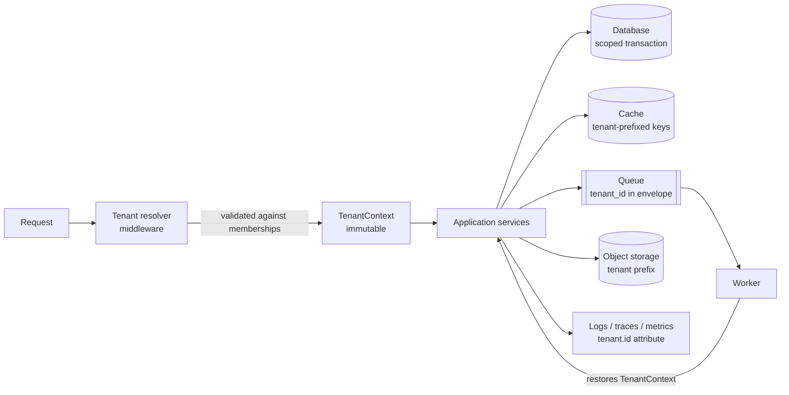

# Multi-Tenant Applications

> A multi-tenant application resolves the tenant once at the edge, carries that context through the whole request, and treats every shared resource — database, cache, queue, logs — as something that must know which tenant it is serving.

---

## What is it?

A **multi-tenant application** is one running copy of a piece of software that serves many customers at the same time, keeping each customer's data and configuration separate. Each customer — usually an organisation, sometimes a single person — is a **tenant**. A tenant is not a user: one tenant typically has many users, and one user may belong to several tenants (a consultant working for two client companies, for example).

The opposite is **single-tenant**: one deployment (or one stack of infrastructure) per customer.

Multi-tenancy is a property of the whole system, not only of the database. The [database side](../databases/multi-tenancy/overview.md) decides where each tenant's rows live; this article covers the application side — how a request learns which tenant it acts for, and how that knowledge reaches every component that stores or emits something.

---

## Why does it matter?

- **Cost per customer.** One deployment amortised over hundreds of tenants is far cheaper than hundreds of deployments. This is what makes low-priced SaaS tiers viable.
- **Onboarding speed.** Creating a tenant becomes a row insert and a few configuration entries instead of provisioning infrastructure.
- **One version to operate.** Every tenant runs the same release, so fixes and features ship once.
- **The risk is concentrated.** Sharing everything means one missing filter can show customer A's data to customer B. A cross-tenant leak is a security incident, usually a contractual one too. The architecture has to make the safe path the default path, not something every developer remembers in every query.

---

## How it works



### 1. Resolving the tenant

The request has to say which tenant it is for. The common sources, from most to least trustworthy:

| Source | Example | Trust |
|---|---|---|
| Token claim | `tenant_id` / `org_id` claim in a signed access token | High — the identity provider signed it |
| Subdomain | `acme.app.test` | Medium — anyone can type any subdomain |
| Path segment | `/t/acme/projects` | Medium — same as subdomain |
| Header | `X-Tenant-Id: …` | Low — fully client-controlled |

Whatever the source, **the resolver validates the requested tenant against the authenticated user's memberships** before trusting it. A subdomain or header only *selects* among the tenants the user already belongs to; it never *grants* access. Users who belong to several tenants can legitimately act on more than one at once (a cross-organisation dashboard), so the resolved value is a **list of tenant ids**, which is often a list of one.

Resolution happens **once, at the edge** (HTTP middleware, gRPC interceptor, queue consumer), and fails closed: no tenant, no request.

### 2. Propagating the context

The resolver produces a `TenantContext` — an immutable value holding the tenant ids (and, usually, the user id and tier). Every layer below reads it; no layer below re-derives it from request input.

How it travels depends on the language:

- **Explicit parameter** — the most visible and testable option.
- **The language's request-scoped context** — `context.Context` in Go, a scoped DI service in ASP.NET Core, `AsyncLocalStorage` in Node.js. Convenient at the infrastructure edge; it should not become an invisible global in domain code.

The language articles show the idiomatic version: [Go](../../languages/go/multi-tenancy.md), [C#](../../languages/csharp/multi-tenancy.md), [Node.js](../../languages/javascript-typescript/runtimes/nodejs/multi-tenancy.md).

In a [hexagonal](hexagonal.md) layout, the resolver is a driving adapter and the scoped database transaction lives in the driven adapter; the domain only sees the `TenantContext` it was handed.

### 3. The data layer

The repository or unit of work opens a transaction and tells the database which tenants it acts for, so the database itself enforces isolation (PostgreSQL row-level security). The mechanics — transaction-local settings, failing closed on an empty scope, pooled connections — are covered in [Passing the Tenant Context](../databases/multi-tenancy/tenant-context.md).

### 4. Every other shared resource

The database is the obvious one; the leaks usually happen elsewhere.

| Resource | Rule |
|---|---|
| Cache | Every key carries the tenant: `t:{tenant_id}:project:{id}`. A key without a tenant prefix is a bug. |
| Queues and events | The message envelope carries `tenant_id`; the consumer **restores** the `TenantContext` from it before doing any work. |
| Object storage | Objects live under a tenant prefix (`tenants/{tenant_id}/…`) and signed URLs are issued per tenant. |
| Logs, traces, metrics | Attach `tenant.id` to every log line and span so incidents can be scoped and per-tenant usage measured. |
| Search indexes | A tenant field on every document plus a mandatory filter — or one index per tenant for large tenants. |

### 5. Noisy neighbours

One tenant's traffic spike should not degrade everyone else.

- **Per-tenant rate limits and quotas** at the edge (requests per second, storage, seats).
- **Per-tier queues** — premium tenants' jobs do not wait behind a free tenant's bulk import.
- **Measure per tenant** — the `tenant.id` telemetry attribute is what makes "which tenant is hot?" answerable.
- **Move outliers out** — a tenant that dominates the load can be moved to dedicated resources (see the hybrid model in the [database overview](../databases/multi-tenancy/overview.md)).

### 6. Tenant lifecycle

- **Onboarding** — create the tenant row, the first membership, default configuration, and any per-tenant resources (storage prefix, quotas) in one idempotent workflow.
- **Migrations** — with shared tables, a schema migration runs once. With schema- or database-per-tenant, it runs N times and needs batching, progress tracking, and a plan for a migration that fails half-way.
- **Offboarding** — export the tenant's data on request, then delete it everywhere it lives: database, caches, object storage, search indexes, backups according to retention policy.

### 7. Jobs that span tenants

Billing runs, nightly reports, and data fixes touch every tenant. Resist giving them a database role that bypasses isolation. Instead, **iterate tenant by tenant**, opening a normal scoped transaction for each one. The job is a little slower and the isolation guarantees still hold. Reserve a bypass role for genuinely cross-tenant analytics, run it on a separate connection, and audit it.

---

## Examples

The same flow in three languages: a middleware that resolves the tenant from the token claim and an optional selector header, validates it against memberships, and builds the context; and a queue consumer that restores it. The language articles show the full versions with their frameworks.

### Go

```go
type TenantContext struct {
    UserID    uuid.UUID
    TenantIDs []uuid.UUID
}

type ctxKey struct{}

func ResolveTenant(members MembershipStore, next http.Handler) http.Handler {
    return http.HandlerFunc(func(w http.ResponseWriter, r *http.Request) {
        user, ok := auth.UserFrom(r.Context())
        if !ok {
            http.Error(w, "unauthenticated", http.StatusUnauthorized)
            return
        }

        allowed, err := members.TenantsOf(r.Context(), user.ID)
        if err != nil {
            http.Error(w, "internal error", http.StatusInternalServerError)
            return
        }

        // The header only selects among the user's tenants; it never grants access.
        selected := allowed
        if h := r.Header.Get("X-Tenant-Id"); h != "" {
            id, err := uuid.Parse(h)
            if err != nil || !slices.Contains(allowed, id) {
                http.Error(w, "forbidden", http.StatusForbidden)
                return
            }
            selected = []uuid.UUID{id}
        }
        if len(selected) == 0 {
            http.Error(w, "forbidden", http.StatusForbidden)
            return
        }

        tc := TenantContext{UserID: user.ID, TenantIDs: selected}
        next.ServeHTTP(w, r.WithContext(context.WithValue(r.Context(), ctxKey{}, tc)))
    })
}

// Queue consumer: the envelope carries the tenant; restore it before any work.
func (c *Consumer) Handle(ctx context.Context, msg Envelope) error {
    tc := TenantContext{TenantIDs: []uuid.UUID{msg.TenantID}}
    ctx = context.WithValue(ctx, ctxKey{}, tc)
    return c.service.Process(ctx, msg.Payload)
}
```

### TypeScript

```typescript
export interface TenantContext {
  readonly userId: string;
  readonly tenantIds: readonly string[];
}

// Fastify hook: runs once per request, before any route handler.
app.addHook("onRequest", async (request, reply) => {
  const user = request.user; // set by the auth plugin
  if (!user) return reply.code(401).send();

  const allowed = await memberships.tenantsOf(user.id);
  const header = request.headers["x-tenant-id"];

  // The header only selects among the user's tenants; it never grants access.
  const selected =
    typeof header === "string" ? allowed.filter((id) => id === header) : allowed;
  if (selected.length === 0) return reply.code(403).send();

  request.tenant = Object.freeze({ userId: user.id, tenantIds: Object.freeze(selected) });
});

// Queue consumer: the envelope carries the tenant; restore it before any work.
export async function handle(msg: Envelope): Promise<void> {
  const tenant: TenantContext = Object.freeze({ userId: msg.actorId, tenantIds: [msg.tenantId] });
  await projectService.process(tenant, msg.payload);
}
```

### C#

```csharp
public sealed record TenantContext(Guid UserId, IReadOnlyList<Guid> TenantIds);

public sealed class TenantResolutionMiddleware(RequestDelegate next)
{
    public async Task InvokeAsync(HttpContext http, IMembershipStore members, TenantContextAccessor accessor)
    {
        if (!Guid.TryParse(http.User.FindFirst("sub")?.Value, out var userId))
        {
            http.Response.StatusCode = StatusCodes.Status401Unauthorized;
            return;
        }

        var allowed = await members.TenantsOfAsync(userId, http.RequestAborted);

        // The header only selects among the user's tenants; it never grants access.
        IReadOnlyList<Guid> selected = allowed;
        if (http.Request.Headers.TryGetValue("X-Tenant-Id", out var header))
        {
            if (!Guid.TryParse(header, out var id) || !allowed.Contains(id))
            {
                http.Response.StatusCode = StatusCodes.Status403Forbidden;
                return;
            }
            selected = [id];
        }
        if (selected.Count == 0)
        {
            http.Response.StatusCode = StatusCodes.Status403Forbidden;
            return;
        }

        accessor.Current = new TenantContext(userId, selected); // scoped service
        await next(http);
    }
}

// Queue consumer: one DI scope per message, context restored from the envelope.
public async Task HandleAsync(Envelope msg, CancellationToken ct)
{
    await using var scope = scopeFactory.CreateAsyncScope();
    scope.ServiceProvider.GetRequiredService<TenantContextAccessor>().Current =
        new TenantContext(msg.ActorId, [msg.TenantId]);
    await scope.ServiceProvider.GetRequiredService<ProjectService>().ProcessAsync(msg.Payload, ct);
}
```

---

## When to use

- B2B SaaS products serving many customer organisations with the same feature set.
- Products with many small or medium customers where per-customer infrastructure would dominate cost.
- Platforms where onboarding has to be self-service and instant.
- Internal platforms shared by several business units that still need data separation.

---

## When NOT to use

- **One customer, or a handful with dedicated installs** — single-tenant is simpler: no resolver, no scoping, no cross-tenant risk.
- **Contracts or regulation require dedicated infrastructure** — physical isolation, customer-managed encryption keys, or data residency per customer may rule out sharing at the application layer, not only the database.
- **Customers need divergent versions or heavy customisation** — multi-tenancy assumes one release for everyone; per-tenant forks defeat it.
- **As a premature optimisation** — a product with three pilot customers can start single-tenant, provided the data model already carries a tenant id so the move later is a migration, not a rewrite.

---

## References

- [Microsoft Azure Architecture Center — Architect multitenant solutions on Azure](https://learn.microsoft.com/en-us/azure/architecture/guide/multitenant/overview)
- [AWS Well-Architected Framework — SaaS Lens](https://docs.aws.amazon.com/wellarchitected/latest/saas-lens/saas-lens.html)
- [AWS Whitepaper — SaaS Architecture Fundamentals](https://docs.aws.amazon.com/whitepapers/latest/saas-architecture-fundamentals/saas-architecture-fundamentals.html)
