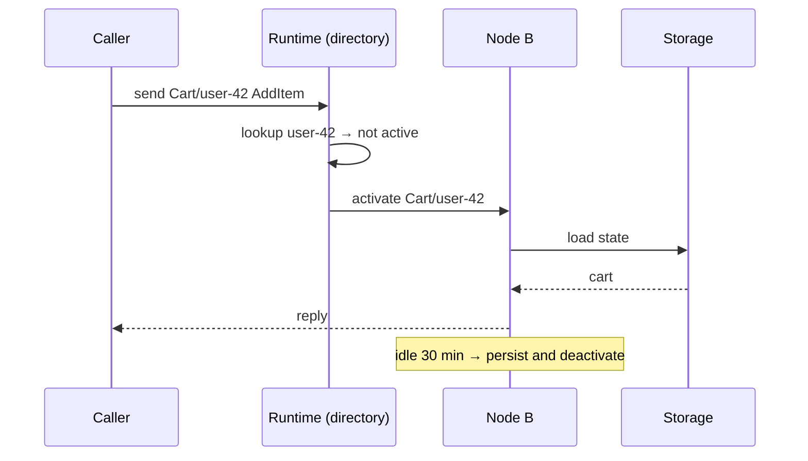

# Actor Model

> Actors are isolated units that own their state and change it only by processing messages one at a time — concurrency without shared memory or locks.

---

## What is it?

An **actor** is a small, independent object with a mailbox: other parts of the program never touch its data directly, they drop messages into its mailbox, and the actor handles those messages one after another. Because only the actor itself ever reads or writes its state, and it does so one message at a time, there is nothing to lock.

The model was described by Carl Hewitt, Peter Bishop, and Richard Steiger in 1973. In response to a message, an actor may do exactly three things:

1. **Send** a finite number of messages to actors whose addresses it knows.
2. **Create** a finite number of new actors.
3. **Decide how to handle the next message** — that is, change its own state or behaviour.

Erlang (1986) turned the model into a production runtime for telephone switches, and its OTP library added the piece that made actors practical at scale: **supervision**.

---

## Why does it matter?

- **No shared memory, no locks.** Each actor's state is private and processed sequentially, so data races inside an actor are impossible by construction. Concurrency comes from running many actors at once, not from many threads touching one object.
- **A natural home for stateful entities.** One actor per cart, device, game room, or account gives each entity a single owner that keeps its state hot in memory — the stateful end of the [stateless/stateful spectrum](overview.md) without hand-written routing.
- **Failure is local and managed.** Supervisors restart crashed actors with a clean state instead of letting one bad input take the whole process down.
- **Location transparency.** An actor is addressed by a reference, not a memory pointer, so the same `send` works whether the actor is in the same process or on another machine. That is what lets actor systems scale out across a cluster.

---

## How it works

### Mailbox, behaviour, state

```
            send(msg)                 ┌─────────────────────────────────┐
 actor A ────────────┐                │ actor B                         │
                     ▼                │                                 │
 actor C ──▶ ┌───────────────┐        │   loop:                         │
             │ mailbox (FIFO)│ ──────▶│     msg = mailbox.next()        │
 timer   ──▶ │ m3 │ m2 │ m1  │        │     state = handle(state, msg)  │
             └───────────────┘        │       ├─ send to other actors   │
                                      │       ├─ spawn child actors     │
                                      │       └─ become(newBehaviour)   │
                                      └─────────────────────────────────┘
```

Thousands to millions of actors are multiplexed over a small pool of threads by a scheduler. An actor with an empty mailbox costs only memory.

### Messaging semantics

- **Tell (fire-and-forget)** is the primitive: send and move on.
- **Ask (request/reply)** is built on top: the sender gets a future that completes with the reply or a timeout. Long chains of asks reintroduce synchronous coupling and are a common source of timeouts and deadlocks (A asks B, B asks A).
- **Delivery is at-most-once** in most runtimes: a message may be lost if a node dies. Anything stronger (at-least-once, deduplication) is built by the application or a persistence layer.
- **Ordering** is guaranteed only per sender–receiver pair: messages from A to B arrive in the order A sent them; messages from A and C to B may interleave.

### Supervision and "let it crash"

Actors form a tree: an actor that spawns children is their supervisor. When a child throws, the supervisor decides:

```
              supervisor
           (one-for-one)
          ┌─────┼─────┐
       child  child  child ✗  ──▶ restart  (fresh state, same address)
                                  resume   (keep state, skip the message)
                                  stop     (remove the child)
                                  escalate (fail the supervisor; its parent decides)
```

"Let it crash" means writing actors for the happy path and letting the supervisor restore a known-good state, instead of defensive error handling for every unexpected case. It works because state that matters is persisted or reconstructible.

### Classic vs virtual actors

| | Classic actors | Virtual actors |
|---|---|---|
| Lifecycle | You spawn and stop them explicitly | They always "exist"; the runtime activates on first message and deactivates when idle |
| Addressing | Reference returned by `spawn` | Identity = type + key (`Cart/user-42`) |
| Placement | Where you created it (or via cluster sharding) | Chosen by the runtime; moves on node failure |
| Failure model | Supervision trees | Runtime re-activates on another node; no supervision tree to design |
| Examples | Erlang/OTP, Akka, Akka.NET, Proto.Actor, Ergo, Hollywood | Orleans (grains), Dapr Actors, Proto.Actor cluster |

Virtual actors, introduced by Microsoft Research's Orleans, trade some control for a much simpler programming model: you never write "create the actor for cart 42 on node B" — you just send to cart 42.



### Persistence

An actor's in-memory state survives a crash only if it is written somewhere:

- **Snapshot** — save the whole state after changes (Orleans `WriteStateAsync`, Dapr state manager).
- **Event sourcing** — persist each change as an event and replay on activation (Akka Persistence, Pekko Persistence). See [Event Sourcing](../event-sourcing.md).

---

## Examples

An account actor and its supervisor (pseudo-code):

```
actor Account(id):
    balance = storage.load(id) or 0

    on Deposit(amount):
        balance += amount
        storage.save(id, balance)
        reply Ok(balance)

    on Withdraw(amount):
        if amount > balance: reply Rejected("insufficient funds"); return
        balance -= amount
        storage.save(id, balance)
        reply Ok(balance)

actor AccountsSupervisor:
    strategy = oneForOne(maxRestarts = 3, within = 1m, on failure → restart)

    on Route(accountId, msg):
        child = children.get(accountId) or spawn(Account(accountId))
        forward msg to child
```

Two `Withdraw` messages for the same account can never interleave, so the balance check and the subtraction are atomic without a lock or a database transaction.

### Frameworks

| Framework | Ecosystem | Style | Notes |
|---|---|---|---|
| Erlang/OTP, Elixir | BEAM VM | Classic | The reference implementation of supervision and "let it crash" |
| Akka | JVM (Scala, Java) | Classic + cluster sharding | Business Source License since 2.7 (2022) |
| Apache Pekko | JVM (Scala, Java) | Classic + cluster sharding | Apache 2.0 fork of Akka 2.6 |
| Akka.NET | .NET | Classic + cluster sharding | Port of Akka; Apache 2.0 |
| Microsoft Orleans | .NET | Virtual (grains) | Originated virtual actors |
| Proto.Actor | Go, .NET | Classic + virtual (cluster) | Go implementation still pre-1.0 |
| Ergo | Go | Classic, OTP-style | Supervisors, applications, Erlang network interop |
| Hollywood | Go | Classic | Focus on throughput and low latency |
| Dapr Actors | Polyglot (sidecar) | Virtual | Same model from Go, JS/TS, .NET, Java, Python |
| Cloudflare Durable Objects | JavaScript/TypeScript (edge) | Actor-like | One instance per ID with transactional storage |
| Ray | Python | Classic | Actors for distributed computing and ML workloads |

Stack-specific usage: [Go](../../../languages/go/stateful-services.md), [Node.js](../../../languages/javascript-typescript/runtimes/nodejs/stateful-services.md), [.NET](../../../languages/csharp/stateful-services.md).

---

## When to use

- Many independent entities, each with its own state and a steady stream of operations — game rooms, IoT device twins, carts, chat sessions, trading accounts.
- High concurrency per entity where locks in a shared database would serialise or deadlock anyway.
- Hot state that must be read with memory latency, not a network round trip.
- Systems that must keep running when individual components fail, and where restarting a component with clean state is an acceptable recovery.
- Workloads that need to scale across a cluster without a hand-built routing and placement layer.

---

## When NOT to use

- **Plain CRUD.** A database with a stateless API is simpler to build, query, and operate.
- **Cross-entity queries.** Actors answer "what is the state of cart 42?" well and "which carts contain item X?" badly. Keep a database or read model for queries.
- **Synchronous request chains.** If most work is "A asks B, which asks C, which asks D", you have built slow RPC with extra failure modes.
- **Strong guarantees across entities.** A transfer between two account actors is a distributed transaction; you need a saga or a process manager, not a single message.
- **Teams new to asynchronous messaging.** Debugging message flows, timeouts, and redelivery is a different skill from debugging call stacks.
- **When at-most-once delivery is unacceptable** and you are not prepared to add persistence and idempotency.

---

## References

- Carl Hewitt, Peter Bishop, Richard Steiger — "A Universal Modular ACTOR Formalism for Artificial Intelligence" (IJCAI, 1973)
- [Erlang/OTP — Design Principles: Supervision](https://www.erlang.org/doc/system/sup_princ.html)
- [Microsoft Research — Orleans: Distributed Virtual Actors for Programmability and Scalability (2014)](https://www.microsoft.com/en-us/research/publication/orleans-distributed-virtual-actors-for-programmability-and-scalability/)
- [Akka documentation — Actors](https://doc.akka.io/libraries/akka-core/current/typed/actors.html)
- [Apache Pekko](https://pekko.apache.org/)
- [Dapr — Actors overview](https://docs.dapr.io/developing-applications/building-blocks/actors/actors-overview/)
