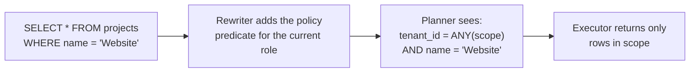

# PostgreSQL Row-Level Security

> Row-level security makes PostgreSQL itself filter which rows every query can see and change, so tenant isolation stops depending on each query in the application remembering a `WHERE` clause.

---

## What is it?

Row-level security (RLS) is a rule attached to a table that decides, row by row, what the current database user may read or write. Once it is switched on, a plain `SELECT * FROM projects` returns only the rows the rule allows — the query does not have to ask for the filter.

The rules are called **policies**. A policy is a boolean SQL expression evaluated for each row; rows for which it is not true are invisible (for reads) or rejected (for writes).

---

## Why does it matter?

In a shared-tables design (see [Overview](overview.md)), every tenant's rows sit in the same table. Without RLS, isolation is a convention: every query, in every service, job, script, and admin tool, must include `WHERE tenant_id = …`. One missed clause — in a new endpoint, a report, a hand-written SQL fix — leaks data across customers, and nothing fails loudly.

RLS changes the failure mode:

- **One source of the rule.** The isolation predicate lives next to the table, not copied into hundreds of queries.
- **Default deny.** A table with RLS enabled and no matching policy returns zero rows and rejects writes. Forgetting something means seeing *nothing*, not *everything*.
- **Every access path is covered.** ORMs, raw SQL, BI tools, and ad-hoc `psql` sessions connecting as the application role all go through the same policy.
- **Defence in depth.** The application can still filter by tenant for clarity and performance; the database enforces it anyway.

---

## How it works

### Switching it on: `ENABLE` and `FORCE`

```sql
ALTER TABLE projects ENABLE ROW LEVEL SECURITY;
ALTER TABLE projects FORCE ROW LEVEL SECURITY;
```

- `ENABLE` makes policies apply to ordinary roles. From that moment, access is **default deny**: with no policy that matches, no rows are visible or modifiable.
- Without `FORCE`, the **table owner bypasses** every policy. `FORCE` makes the owner subject to the policies too. Use it, so that code accidentally running as the owner fails closed instead of reading everything.
- A side effect of `FORCE`: data migrations and backfills run as the owner now see nothing unless a policy lets them in. Run them with an explicit tenant scope, or through a dedicated maintenance role with `BYPASSRLS` used only for that.

### Policies: what each clause does

```sql
CREATE POLICY name ON table
  [ AS { PERMISSIVE | RESTRICTIVE } ]
  [ FOR { ALL | SELECT | INSERT | UPDATE | DELETE } ]
  [ TO role [, ...] ]
  [ USING ( expression ) ]
  [ WITH CHECK ( expression ) ];
```

| Clause | Role |
|---|---|
| `USING` | Filters **existing** rows — which rows `SELECT` returns and which rows `UPDATE`/`DELETE` can target. Rows failing it are skipped silently. |
| `WITH CHECK` | Validates **new** row versions — rows written by `INSERT` and the result of `UPDATE`. A row failing it raises an error (SQLSTATE `42501`, `insufficient_privilege`). |
| `FOR command` | Which commands the policy applies to. `ALL` covers every command. |
| `TO role` | Which roles the policy applies to. Without it (or with `PUBLIC`), it applies to everyone. |
| `PERMISSIVE` (default) | Permissive policies for the same command are combined with **OR** — any one of them grants access. |
| `RESTRICTIVE` | Restrictive policies are combined with **AND** with the permissive result — every one of them must pass. |

If `WITH CHECK` is omitted, PostgreSQL uses the `USING` expression as the check. Writing both explicitly makes the intent visible in review.

Per command:

| Command | `USING` | `WITH CHECK` |
|---|---|---|
| `SELECT` | ✓ | — |
| `INSERT` | — | ✓ |
| `UPDATE` | ✓ (which rows can be updated) | ✓ (what they can become) |
| `DELETE` | ✓ | — |

### Roles: who is subject to RLS

Two roles keep the model honest:

- **`app_owner`** — owns the schema and the tables, runs migrations. Never used by the application at runtime.
- **`app_user`** — the role the application logs in as. It owns nothing, has `NOBYPASSRLS`, and has only the table privileges it needs (`SELECT`, `INSERT`, `UPDATE`, `DELETE`).

Who **bypasses** policies:

| Who | Bypasses RLS? |
|---|---|
| Superusers | Always |
| Roles with `BYPASSRLS` | Always |
| The table owner | Yes, unless the table has `FORCE ROW LEVEL SECURITY` |
| Everyone else | No |

Unique, primary-key, and foreign-key checks also run without RLS, to keep integrity. That is intentional, but it means a unique constraint across tenants can reveal that a value exists in another tenant (a "duplicate key" error). Scope unique constraints per tenant: `UNIQUE (tenant_id, slug)`.

Setting `row_security = off` does *not* bypass RLS: it makes any query that would be filtered raise an error instead. Backup tools use it so they never produce a silently incomplete dump.

### How a policy reaches the plan



The policy predicate is added to the query before planning, and it is evaluated **before** user-supplied conditions, so a user function in the `WHERE` clause cannot observe rows the policy hides. The exception is functions marked `LEAKPROOF` (most built-in comparison operators are), which the planner may evaluate earlier — that is what lets an index on the user's condition still be used.

### Performance

- **Index the tenant column, leading.** Policies add `tenant_id = …` to every query, so composite indexes should start with it: `(tenant_id, created_at)`, `(tenant_id, name)`. Primary keys can stay on `id`.
- **Keep the predicate stable.** `current_setting(...)` is a `STABLE` function, so the planner evaluates the scope once per scan and can use it as an index condition. Avoid policies that call `VOLATILE` functions or run a sub-`SELECT` per row (for example, looking up memberships inside the policy).
- **`= ANY(array)` works with indexes.** A `uuid[]` scope with one element performs like `=`; with several, it becomes an index scan over each value.
- **Read the plan.** Run `EXPLAIN` *as `app_user`* with a scope set — as a superuser or the owner without `FORCE`, the policy is not applied and the plan lies.

---

## Examples

### Schema, roles, and the policy (SQL)

```sql
-- roles (run once, as a superuser or a role with CREATEROLE)
CREATE ROLE app_owner NOLOGIN;
CREATE ROLE app_user  LOGIN NOBYPASSRLS;   -- password managed outside SQL files

-- tables (run as app_owner)
CREATE TABLE tenants (
  id   uuid PRIMARY KEY,
  name text NOT NULL
);

CREATE TABLE memberships (
  user_id   uuid NOT NULL,
  tenant_id uuid NOT NULL REFERENCES tenants(id),
  PRIMARY KEY (user_id, tenant_id)
);

CREATE TABLE projects (
  id        uuid PRIMARY KEY DEFAULT gen_random_uuid(),
  tenant_id uuid NOT NULL REFERENCES tenants(id),
  name      text NOT NULL,
  UNIQUE (tenant_id, name)
);
CREATE INDEX projects_tenant_id_idx ON projects (tenant_id);

ALTER TABLE projects ENABLE ROW LEVEL SECURITY;
ALTER TABLE projects FORCE  ROW LEVEL SECURITY;

-- the isolation policy
CREATE POLICY tenant_isolation ON projects
  AS PERMISSIVE
  FOR ALL
  TO app_user
  USING      (tenant_id = ANY (coalesce(nullif(current_setting('app.tenant_ids', true), '')::uuid[], '{}')))
  WITH CHECK (tenant_id = ANY (coalesce(nullif(current_setting('app.tenant_ids', true), '')::uuid[], '{}')));

-- privileges for the runtime role
GRANT SELECT ON tenants, memberships TO app_user;
GRANT SELECT, INSERT, UPDATE, DELETE ON projects TO app_user;
```

The predicate reads the scope from the transaction-local setting `app.tenant_ids` (a `uuid[]` literal such as `{00000000-0000-0000-0000-00000000000a}`). `nullif(..., '')` and `coalesce(..., '{}')` make an absent or empty setting mean "no tenants" — see [Passing the Tenant Context](tenant-context.md) for why both are needed.

### A restrictive policy on top

Permissive policies grant; restrictive ones narrow. For example, archived projects are read-only for everybody, whatever other policies say:

```sql
ALTER TABLE projects ADD COLUMN archived boolean NOT NULL DEFAULT false;

CREATE POLICY archived_read_only ON projects
  AS RESTRICTIVE
  FOR UPDATE
  TO app_user
  USING (NOT archived);
```

An `UPDATE` now needs `tenant_isolation` **and** `archived_read_only` to pass.

### Checking the plan

```sql
SET ROLE app_user;
BEGIN;
SELECT set_config('app.tenant_ids', '{00000000-0000-0000-0000-00000000000a}', true);
EXPLAIN SELECT * FROM projects WHERE name = 'Website';
COMMIT;
RESET ROLE;
```

```text
Index Scan using projects_tenant_id_name_key on projects
  Index Cond: ((tenant_id = ANY (COALESCE((NULLIF(current_setting('app.tenant_ids'::text, true), ''::text))::uuid[], '{}'::uuid[])))
               AND (name = 'Website'::text))
```

The policy predicate appears in the plan as an index condition on the `(tenant_id, name)` unique index.

### The application connects as `app_user`

The application never connects as the owner or a superuser. The connection string comes from configuration and names `app_user`.

**Go (pgx):**

```go
// DATABASE_URL points at the database with user app_user.
pool, err := pgxpool.New(ctx, os.Getenv("DATABASE_URL"))
if err != nil {
	return fmt.Errorf("connect: %w", err)
}
defer pool.Close()
```

**TypeScript (node-postgres):**

```ts
import { Pool } from "pg";

// DATABASE_URL points at the database with user app_user.
export const pool = new Pool({ connectionString: process.env.DATABASE_URL });
```

**C# (Npgsql):**

```csharp
// ConnectionStrings:App points at the database with Username=app_user.
await using var dataSource = NpgsqlDataSource.Create(
    builder.Configuration.GetConnectionString("App")!);
```

How each of them sets the tenant scope per transaction is shown in [Passing the Tenant Context](tenant-context.md).

---

## When to use

- **Shared tables** hold the data of more than one tenant.
- The database is reached by **more than one access path** — API, workers, scheduled jobs, BI, support tooling.
- You want **defence in depth**: application filters for intent and performance, the database for enforcement.
- Several developers or teams write queries against the same tables, and a code-review checklist is not a sufficient guarantee.

---

## When NOT to use

- **Database-per-tenant or schema-per-tenant** models — the boundary is already the database or the schema; RLS adds cost without adding isolation.
- **The application must connect as the owner or a superuser** (some managed platforms or legacy setups) — the policies would be bypassed; fix the roles first.
- **Cross-tenant analytics** — do not weaken the tenant policy with "unless admin" branches. Use a separate reporting role (or replica) with its own explicit policies or `BYPASSRLS`, kept out of the request path.
- **You do not control the database roles** — RLS is only as good as the guarantee that runtime code runs as a role subject to it.
- **Per-row policies that need complex lookups** (a sub-`SELECT` into a permissions table for each row) on hot tables — resolve permissions once in the application and pass the result as the scope instead.

---

## References

- [PostgreSQL — Row Security Policies](https://www.postgresql.org/docs/current/ddl-rowsecurity.html)
- [PostgreSQL — `CREATE POLICY`](https://www.postgresql.org/docs/current/sql-createpolicy.html)
- [PostgreSQL — `ALTER TABLE` (`ENABLE`/`FORCE ROW LEVEL SECURITY`)](https://www.postgresql.org/docs/current/sql-altertable.html)
- [AWS Database Blog — Multi-tenant data isolation with PostgreSQL Row Level Security](https://aws.amazon.com/blogs/database/multi-tenant-data-isolation-with-postgresql-row-level-security/)
