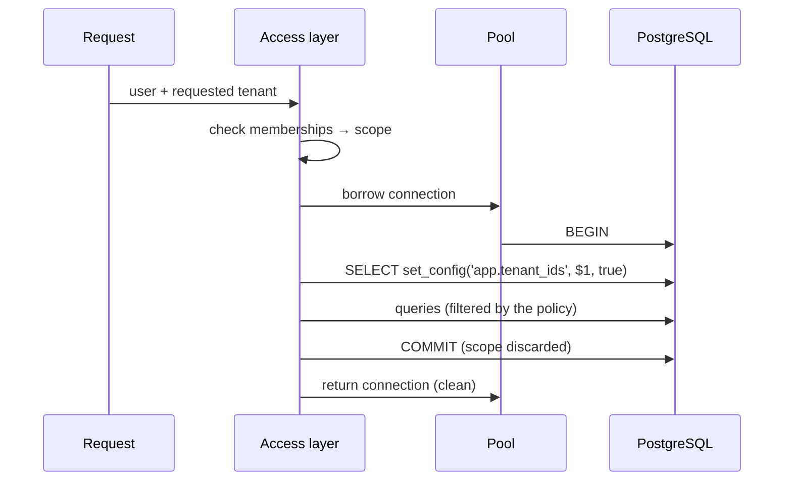

# Passing the Tenant Context

> A row-level security policy is only as good as the tenant scope the application hands to the database — that scope must live for one transaction, be validated when it is set, and deny everything when it is missing.

---

## What is it?

The tenant context is how the application tells PostgreSQL "this transaction acts on behalf of these tenants". The [RLS policy](postgres-row-level-security.md) reads that value on every row it checks; the application's job is to set it correctly before running any query.

In PostgreSQL the usual carrier is a **custom configuration setting** — a namespaced variable such as `app.tenant_ids` — set for the current transaction only and read inside the policy with `current_setting`.

---

## Why does it matter?

Applications do not open a connection per request; they borrow one from a **pool** and give it back. Anything attached to the *session* — a `SET`, a temporary table, a prepared statement — survives on that connection and is inherited by whichever request borrows it next. A tenant scope set at session level is therefore a time bomb: the next request that forgets to set its own scope runs with someone else's.

Getting the context right means:

- **Transaction scope** — the value disappears at `COMMIT` or `ROLLBACK`, so nothing leaks to the next borrower.
- **Fail closed** — no scope, or an empty one, means no rows, never all rows.
- **Trusted source** — the list of tenants comes from the access layer (what the authenticated user is allowed to see), never straight from request input.

---

## How it works

### Setting the scope for one transaction

```sql
BEGIN;
SELECT set_config('app.tenant_ids', '{00000000-0000-0000-0000-00000000000a}', true);
-- … queries …
COMMIT;   -- the setting is gone
```

`set_config(name, value, is_local)` with `is_local = true` is the function form of `SET LOCAL`: the value lasts until the end of the current transaction. Prefer the function over `SET LOCAL` in application code, because the value can be passed as a **bind parameter** — `SET` does not accept parameters, which pushes people towards string concatenation.

Outside a transaction block, each statement is its own transaction, so a `set_config(..., true)` run alone is discarded immediately. The helper must open the transaction first.

### Reading the scope in the policy

```sql
tenant_id = ANY (coalesce(nullif(current_setting('app.tenant_ids', true), '')::uuid[], '{}'))
```

Each layer handles one failure mode:

| Piece | Why it is there |
|---|---|
| `current_setting(name, true)` | The second argument (`missing_ok`) returns `NULL` instead of raising an error when the setting was never defined in this session. |
| `nullif(..., '')` | Once a custom setting has been set in a session — even with `SET LOCAL`, even in a rolled-back transaction — PostgreSQL keeps it defined with an **empty string** after the transaction ends. Without `nullif`, `''::uuid[]` raises *malformed array literal* on every later query on that pooled connection. |
| `::uuid[]` | Parses the value; a malformed id makes the query fail instead of silently matching nothing useful. |
| `coalesce(..., '{}')` | Absent scope becomes an empty array. |
| `= ANY (...)` | Matches the row's tenant against the list. Against an empty array it is never true: **fail closed**. |

### One tenant or a list

Most requests act on exactly one tenant. Some legitimately span several — a consultant who belongs to three client organisations, a dashboard that aggregates a user's workspaces. Using a `uuid[]` for both cases keeps a single policy: a single tenant is a one-element array (`{…0a}`), a list is `{…0a,…0b}`.

### Where the list comes from

The scope must be the output of an **authorization decision**, not an echo of the request:

```
request ─► authenticate (who is the user?)
        ─► resolve requested tenant (subdomain, path, header, token claim)
        ─► authorize: intersect with the user's memberships
        ─► scope = the allowed tenant ids (never empty)
        ─► open transaction, set app.tenant_ids, run queries
```

A header like `X-Tenant-Id` is a *request* for a tenant, not proof of access. The access layer checks it against the user's memberships before it becomes the scope. See [Multi-Tenant Applications](../../architecture/multi-tenancy.md) for tenant resolution.

### Validating when the scope is set

Validate in two places:

1. **In the application** — parse every id as a UUID, reject an empty list, and build the list only from the authorization result.
2. **Optionally, in the database** — instead of letting `app_user` call `set_config` directly, expose a `SECURITY DEFINER` function that rejects empty lists, `NULL` elements, and unknown tenant ids. This guards against application bugs (an empty list that should have been an error, a stale id); it does not protect against a compromised application, which could still call `set_config` itself.

The membership check stays in the application, because only the application knows which user is authenticated.

### Connection pools

| Mechanism | Lives until | Safe with a pool? |
|---|---|---|
| `SET app.tenant_ids = …` / `set_config(..., false)` | End of the session (connection) | **No** — leaks to the next borrower |
| `SET LOCAL` / `set_config(..., true)` | End of the transaction | Yes |
| A connection (or pool) per tenant | — | Does not scale past a handful of tenants |

External poolers make this stricter. PgBouncer in **transaction pooling** mode hands a server connection to a client for one transaction at a time and does not support session-level `SET`/`RESET` at all; transaction-local settings work because they end with the transaction PgBouncer is already scoped to.



---

## Examples

### SQL: the setting's lifetime

```sql
BEGIN;
SELECT set_config('app.tenant_ids', '{00000000-0000-0000-0000-00000000000a}', true);
SELECT current_setting('app.tenant_ids', true);   -- {00000000-0000-0000-0000-00000000000a}
COMMIT;

SELECT current_setting('app.tenant_ids', true);   -- '' (empty string, not NULL)
SELECT count(*) FROM projects;                     -- 0: no scope, no rows
```

### SQL: an optional validating setter

```sql
CREATE SCHEMA app AUTHORIZATION app_owner;

CREATE FUNCTION app.set_tenants(ids uuid[]) RETURNS void
  LANGUAGE plpgsql
  SECURITY DEFINER
  SET search_path = pg_catalog, public
AS $$
BEGIN
  IF ids IS NULL OR cardinality(ids) = 0 OR array_position(ids, NULL) IS NOT NULL THEN
    RAISE EXCEPTION 'tenant scope must be a non-empty list of ids'
      USING ERRCODE = '22023';  -- invalid_parameter_value
  END IF;

  IF EXISTS (
    SELECT 1 FROM unnest(ids) AS t(id)
    WHERE NOT EXISTS (SELECT 1 FROM public.tenants WHERE tenants.id = t.id)
  ) THEN
    RAISE EXCEPTION 'unknown tenant id in scope' USING ERRCODE = '22023';
  END IF;

  PERFORM set_config('app.tenant_ids', ids::text, true);
END;
$$;

REVOKE ALL ON FUNCTION app.set_tenants(uuid[]) FROM PUBLIC;
GRANT EXECUTE ON FUNCTION app.set_tenants(uuid[]) TO app_user;

-- usage, inside a transaction
SELECT app.set_tenants('{00000000-0000-0000-0000-00000000000a}');
```

The function's `SET search_path` clause pins name resolution, a standard precaution for `SECURITY DEFINER` functions; it does not affect `app.tenant_ids`, which persists until the end of the caller's transaction.

### Application helpers

Each helper opens a transaction, sets the scope with a **bind parameter**, runs the caller's work on that transaction, and commits — or rolls back on error. The cast `$1::uuid[]` makes PostgreSQL reject a malformed id; `::text` turns the array into the literal stored in the setting.

**Go (pgx v5):**

```go
var ErrNoTenantScope = errors.New("tenant scope is empty")

func WithTenants(ctx context.Context, pool *pgxpool.Pool, ids []uuid.UUID, fn func(pgx.Tx) error) error {
	if len(ids) == 0 {
		return ErrNoTenantScope
	}
	return pgx.BeginTxFunc(ctx, pool, pgx.TxOptions{}, func(tx pgx.Tx) error {
		if _, err := tx.Exec(ctx,
			"SELECT set_config('app.tenant_ids', $1::uuid[]::text, true)", ids); err != nil {
			return fmt.Errorf("set tenant scope: %w", err)
		}
		return fn(tx)
	})
}

// usage
err := WithTenants(ctx, pool, scope, func(tx pgx.Tx) error {
	_, err := tx.Exec(ctx, "UPDATE projects SET name = $1 WHERE id = $2", name, id)
	return err
})
```

**TypeScript (node-postgres):**

```ts
import type { Pool, PoolClient } from "pg";

export async function withTenants<T>(
  pool: Pool,
  ids: readonly string[],
  fn: (client: PoolClient) => Promise<T>,
): Promise<T> {
  if (ids.length === 0) throw new Error("tenant scope is empty");
  const client = await pool.connect();
  try {
    await client.query("BEGIN");
    await client.query("SELECT set_config('app.tenant_ids', $1::uuid[]::text, true)", [ids]);
    const result = await fn(client);
    await client.query("COMMIT");
    return result;
  } catch (err) {
    await client.query("ROLLBACK");
    throw err;
  } finally {
    client.release();
  }
}

// usage
const projects = await withTenants(pool, scope, async (client) =>
  (await client.query("SELECT id, name FROM projects ORDER BY name")).rows,
);
```

**C# (Npgsql):**

```csharp
public static async Task WithTenantsAsync(
    NpgsqlDataSource dataSource,
    IReadOnlyList<Guid> ids,
    Func<NpgsqlTransaction, Task> work,
    CancellationToken ct = default)
{
    if (ids.Count == 0)
        throw new InvalidOperationException("Tenant scope is empty.");

    await using var connection = await dataSource.OpenConnectionAsync(ct);
    await using var transaction = await connection.BeginTransactionAsync(ct);

    await using (var command = new NpgsqlCommand(
        "SELECT set_config('app.tenant_ids', $1::uuid[]::text, true)", connection, transaction))
    {
        command.Parameters.Add(new NpgsqlParameter { Value = ids.ToArray() });
        await command.ExecuteNonQueryAsync(ct);
    }

    await work(transaction);
    await transaction.CommitAsync(ct);   // disposing without commit rolls back
}

// usage
await WithTenantsAsync(dataSource, scope, async tx =>
{
    await using var cmd = new NpgsqlCommand(
        "UPDATE projects SET name = $1 WHERE id = $2", tx.Connection, tx);
    cmd.Parameters.Add(new NpgsqlParameter { Value = name });
    cmd.Parameters.Add(new NpgsqlParameter { Value = id });
    await cmd.ExecuteNonQueryAsync();
});
```

In all three, every query of the unit of work must go through the transaction handle (`tx`, `client`, `transaction`). A query sent through the pool instead runs on another connection, without the scope — and returns nothing, because the policy fails closed. See [Pitfalls](pitfalls.md).

---

## When to use

- Any design with **shared tables and RLS** behind a **connection pool** — which is every production application.
- When the application connects with **a single database role** for all tenants (the normal case) and the tenant must be carried per transaction.
- When an external pooler (PgBouncer, RDS Proxy, Supavisor) runs in **transaction mode**.

---

## When NOT to use

These are the ways *not* to carry the tenant context:

- **Session-level `SET`** (or `set_config(..., false)`) with a pool — the scope survives the request and leaks to the next borrower.
- **The tenant in the connection's user name** (one database role per tenant) — every tenant needs its own pool, connections multiply by tenants, and onboarding means `CREATE ROLE`. It does not scale past a handful of tenants.
- **String concatenation** to build the value (`"SET LOCAL app.tenant_ids = '" + id + "'"`) — an injection point in the one statement that controls isolation. Use `set_config` with a parameter.
- **Request input as the scope** — a header or query-string value used directly, without the membership check.
- **A permissive fallback** when the scope is absent (`OR current_setting(...) IS NULL`, `coalesce(..., <all tenants>)`) — it turns every forgotten scope into a full-table read.

---

## References

- [PostgreSQL — System administration functions (`set_config`, `current_setting`)](https://www.postgresql.org/docs/current/functions-admin.html)
- [PostgreSQL — `SET` (`LOCAL`)](https://www.postgresql.org/docs/current/sql-set.html)
- [PostgreSQL — `CREATE FUNCTION` (writing `SECURITY DEFINER` functions safely)](https://www.postgresql.org/docs/current/sql-createfunction.html)
- [PgBouncer — Features (SQL feature map for pooling modes)](https://www.pgbouncer.org/features.html)
